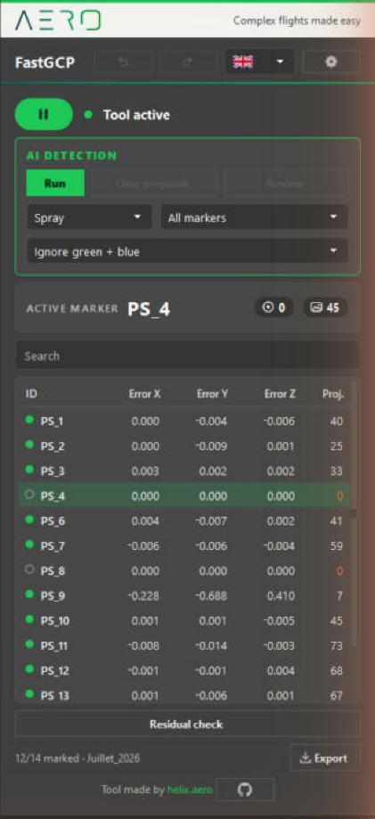
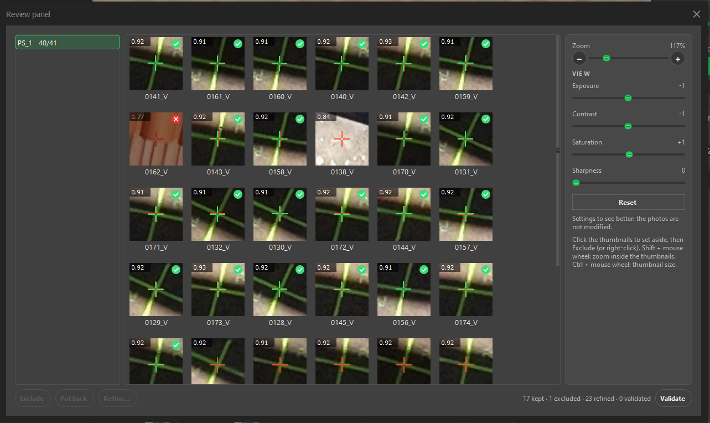
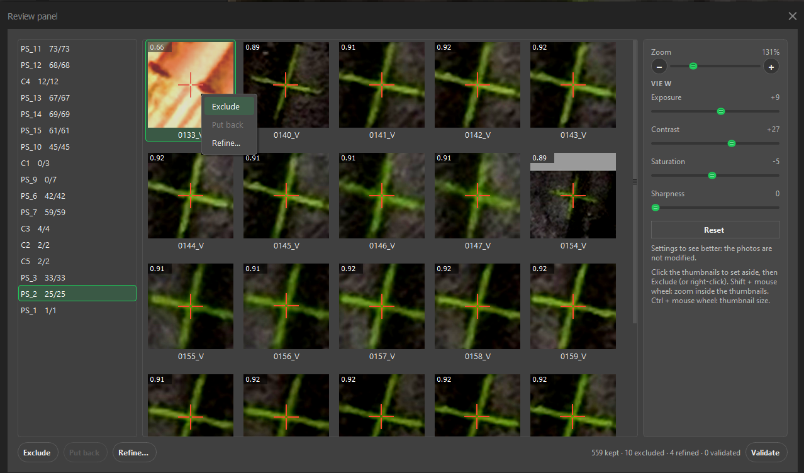
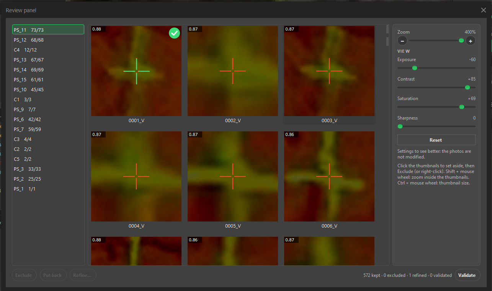
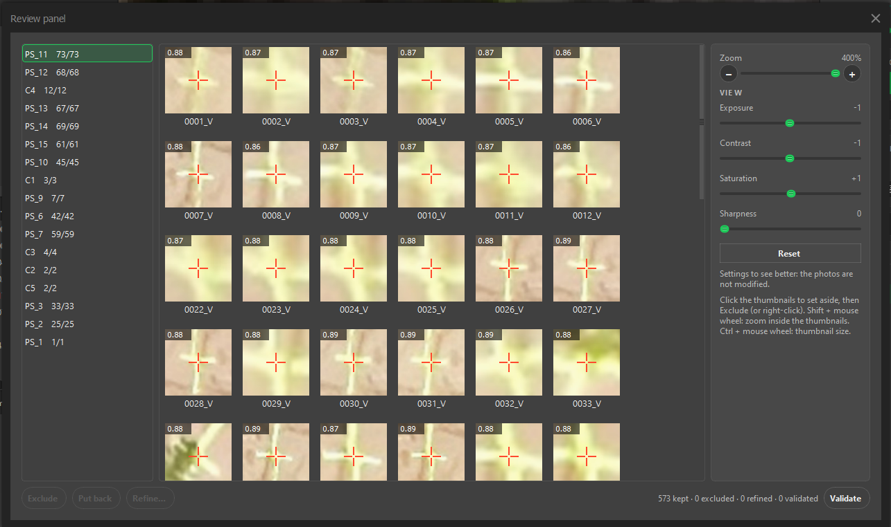
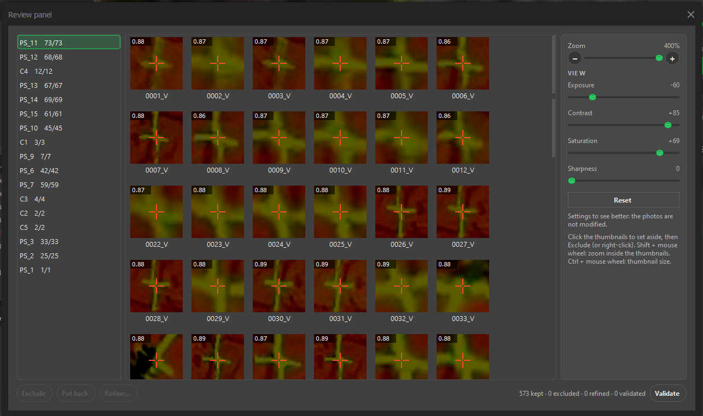
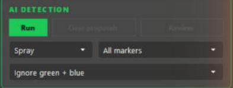
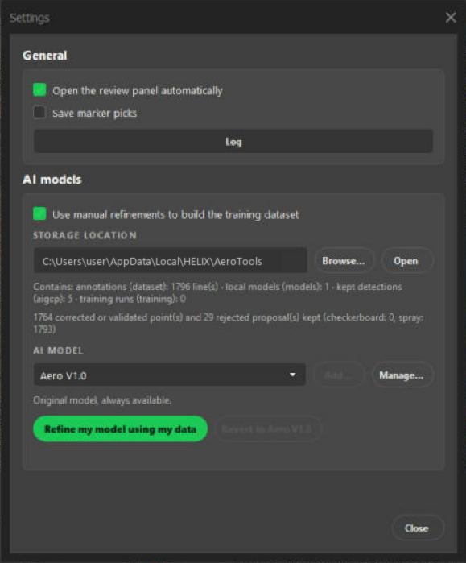

   
  

  <a href="https://helix.aero">
    <picture>
      <source media="(prefers-color-scheme: dark)" srcset="assets/logo/helix-aero-AERO-blanc-512px.png">
      
    </picture>
  </a>

<h3 align="center">Complex flights made easy</h3>

  Planification de vol pour la cartographie aérienne, par drone et par aéronef habité. 
  <a href="https://helix.aero"><b>Découvrir HELIX Flight Planner</b></a>&nbsp;&nbsp;&nbsp;&middot;&nbsp;&nbsp;&nbsp;<a href="https://helix.aero"><b>Réserver une démo</b></a>

---

## À propos de HELIX AERO

HELIX AERO est un logiciel de planification de vol pour la cartographie aérienne, conçu par des géomètres et des ingénieurs en
Corse. Nous l'avons commencé à partir de notre propre travail de levé : préparer des missions, les voler et contrôler les données
qu'elles produisent.

- **HELIX Flight Planner** est une application de bureau qui transforme un polygone en mission LiDAR ou de photogrammétrie
  optimisée, vérifiée avant le vol, pour drones et aéronefs habités. Elle calcule sur la carte graphique de votre ordinateur,
  fonctionne hors ligne, et exporte les missions pour les aéronefs DJI (MAVLink arrive). Elle est en accès anticipé.
- **HELIX FMS** guide le pilote d'un aéronef de levé habité le long de la trajectoire planifiée, sur iPad. Il est en bêta.

AeroTools, ci-dessous, est la part de notre outillage quotidien que nous partageons avec la communauté Metashape.

[Découvrir HELIX Flight Planner →](https://helix.aero)

---

# AeroTools

**Pointez les points de calage au sol dans Agisoft Metashape en une fraction du temps, à la main ou avec une IA qui propose les pointés.**

  &nbsp;&nbsp;&nbsp;
  &nbsp;&nbsp;&nbsp;
  

[Tutoriel](docs/TUTORIAL.fr.md) · [English version](README.md) · [Développement](docs/DEVELOPMENT.md)

Nous cartographions avec des drones et nous pointons beaucoup de points de calage au sol (GCP). Metashape sait le faire, mais le
déroulement est lourd : on fait défiler des centaines de photos pour trouver celles qui voient un marqueur, on les ouvre une à
une, on zoome à la main, on clique, et on recommence. Nous avons donc écrit un outil pour nous. Il nous a fait gagner assez de
temps pour que nous décidions de le partager.

**FastGCP** est cet outil. Il ajoute un menu **Aero** à Metashape et fait deux choses dans un seul panneau : le **pointage
manuel** et la **détection IA**, qui propose les pointés pour que vous les passiez en revue.

## Fonctionnalités

- **Pointage manuel rapide.** Choisissez un marqueur : le panneau Photos se filtre sur les photos qui le voient. Cliquez sur la
  cible : le point est posé exactement là où vous avez cliqué, et la photo suivante s'ouvre toute seule, zoomée sur le marqueur.
  Ctrl+Z reprend le dernier point, Ctrl+Y le rétablit.
- **Tableau des marqueurs.** Erreurs X, Y et Z et nombre de projections pour chaque marqueur, triable et filtrable. Sélectionnez
  plusieurs marqueurs avec Maj ou Ctrl et supprimez leurs projections, ou les marqueurs eux-mêmes, par un clic droit.
- **Contrôle des résidus.** Liste les marqueurs à surveiller : résidu élevé, ou moins de 3 photos pointées.
- **Détection IA.** Une IA propose un point sur chaque photo qui devrait voir le marqueur, et vous passez les propositions en revue.
- **Review panel.** Une vignette par photo. Excluez les mauvaises propositions, affinez les imprécises, validez le reste.
- **Rapport PDF et tableau CSV.** Un clic sur le bouton **Exporter**.
- Interface en français et en anglais. Mettez l'outil en pause et Metashape se comporte comme d'habitude.

## Installation

Il faut Metashape Pro 2.x sous Windows. Nous l'utilisons tous les jours avec Metashape 2.2.

1. Cliquez sur **Télécharger la dernière version** en haut de cette page (ou clonez ce dépôt), puis décompressez-le où vous voulez.
2. Double-cliquez sur **`CLICK HERE TO INSTALL.bat`** (à la racine du dossier décompressé). Un seul installeur fait tout : il ajoute le menu **Aero** à Metashape et met en place la détection IA (Python et un moteur de détection léger, environ 100 Mo, une à deux minutes). Une fenêtre affiche « Please wait... » avec la progression ; ne la fermez pas.
3. Redémarrez Metashape. Le menu **Aero** est là.

**Aero > FastSpace** scanne un disque à la recherche des anciens projets Metashape et libère de la place : les alléger (tu choisis ce qu'on
retire : nuages denses, cartes de profondeur, orthophotos, avec la place que chacun libère) ou les supprimer, à la corbeille ou définitivement.

Plus tard, **Aero > Vérifier les mises à jour…** apporte la dernière version depuis GitHub (avec la liste des changements et leur
poids). L'installeur demande quel moteur de détection vous voulez (léger, précis, ou les deux) et s'il faut ajouter les outils de
réentraînement ; les paramètres de FastGCP peuvent ensuite installer chacun d'un clic.

L'installeur écrit un petit lanceur dans `%LOCALAPPDATA%\Agisoft\Metashape Pro\scripts\`. Rien d'autre n'est touché.
`install\desinstaller_aerotools.bat` le retire.

> [!NOTE]
> La détection IA tourne dans un Python séparé et léger (ONNX Runtime, environ 100 Mo ; ni `torch`, ni carte graphique nécessaire).
> Le même installeur le met en place (relancez-le quand vous voulez : il ne refait que ce qui manque). Les outils de pointage manuel
> fonctionnent sans. Seul le réentraînement du modèle (« Affiner mon modèle ») demande les outils lourds (`torch`, environ 3 Go) :
> double-cliquez sur `install\installer_entrainement.bat` si vous en avez besoin. Voir le [tableau de dépannage](docs/TUTORIAL.fr.md#9-dépannage).

## Démarrage rapide

1. **Aero > FastGCP** (F8) ouvre le panneau à droite de Metashape.
2. Choisissez un marqueur dans le panneau ou dans le panneau Reference, puis cliquez sur la cible dans la vue photo. Recommencez :
   la photo suivante s'ouvre toute seule.
3. Ou laissez l'IA faire un premier passage : choisissez le type de cible et la portée, puis appuyez sur **Lancer**. Le Review
   panel s'ouvre à la fin de la détection.
4. Dans le Review panel, cliquez les mauvaises vignettes et appuyez sur **Exclure**, ou sur **Affiner…** pour poser le point
   vous-même, puis appuyez sur **Valider**.

Après **Affiner…**, la vignette montre votre croix verte et une coche verte :

Des curseurs d'exposition, de contraste, de saturation et de netteté aident l'œil dans le Review panel. Ils ne modifient jamais
vos photos.

| Avant | Après |
|---|---|
|  |  |

Le [tutoriel](docs/TUTORIAL.fr.md) passe en revue chaque bouton.

## Détection IA

- Deux types de cible, chacun avec son modèle : **Damier** (damier 2×2) et **Bombe** (marque à la bombe ou à la craie). Ils ne se
  mélangent jamais.
- Portée : les marqueurs sélectionnés, ou tous les marqueurs qui ont une position 3D.
- Le calcul tourne dans un processus séparé : Metashape reste utilisable, et un bouton **Annuler** l'arrête.
- Une proposition n'est pas un point posé : elle ne remplace jamais un point que vous avez placé. Deux contrôles écartent les
  détections douteuses : celles trop éloignées de l'endroit où les autres projections du marqueur disent qu'il devrait être, et
  celles qui ne se recoupent pas en un seul point 3D.
- **Aero V1.0** est le modèle que nous livrons, toujours présent. Depuis la fenêtre Paramètres, vous pouvez réentraîner une copie
  **Locale** sur vos propres décisions du Review panel (exclusions, affinages, validations). Le modèle d'origine n'est jamais
  modifié, et **Revenir à Aero V1.0** le rétablit à tout moment. Ajouter un modèle de votre cru (**Ajouter…**) n'est pas encore
  possible.

> [!IMPORTANT]
> Le réentraînement est une expérience, pas une mise à niveau. Dans notre seul essai (type Bombe, 798 exemples positifs et 208
> négatifs, 75 secondes sur une RTX 4070), le nouveau modèle a obtenu un mAP50 de 0,9762 contre 0,9784 pour Aero V1.0 sur les
> cibles mises de côté : aucune différence mesurable. Nous ne promettons pas qu'il améliore la détection sur vos données.
> Comparez, et revenez en arrière s'il ne fait pas mieux.

## Rapport PDF

**Exporter > Rapport PDF** écrit un rapport du chunk courant : chiffres clés, graphiques d'erreurs, tableau des marqueurs et
captures d'écran. Après une détection IA, il ajoute une section *Photos pointées par l'IA* : un bloc par marqueur avec l'écart de
pointage et la confiance de l'IA, une vignette par photo, et les photos exclues aussi, assombries et barrées d'une grande croix
rouge, laissées hors des statistiques. **Exporter > Tableau CSV** écrit le tableau des marqueurs.

Voir [un exemple de rapport](docs/exemple_rapport_gcp.pdf) (sans la section IA).

## État du projet

Nous utilisons AeroTools sur de vrais projets, mais sur peu de configurations pour l'instant. L'API de la vue photo de Metashape
est peu documentée : attendez-vous à quelques aspérités. La détection IA est récente : nous l'avons mesurée sur nos propres
projets, et elle marche mieux sur les types de cibles pour lesquels elle a été entraînée.

Si quelque chose casse, ouvrez une issue et collez les lignes du Journal (fenêtre Paramètres). Cela accélère beaucoup la correction.

## Développement

Issues, idées et pull requests sont les bienvenues.

- Forkez le dépôt, travaillez sur une branche et ouvrez une pull request vers `dev`.
- Le code tourne dans le Python 3.9 embarqué de Metashape avec PySide2, et aussi sous PySide6. Pas de dépendance en plus, s'il vous plaît.
- Lancez les tests avec `python -m pytest tests -q` : ils n'ont pas besoin de Metashape.
- En envoyant une pull request, vous acceptez que votre contribution soit publiée sous la même licence, et que HELIX AERO puisse aussi la proposer sous d'autres conditions, y compris commerciales.
- Plus de détails dans [docs/DEVELOPMENT.md](docs/DEVELOPMENT.md).

## Licence

[PolyForm Noncommercial 1.0.0](LICENSE). Copyright 2026 HELIX AERO.

Le code et le modèle d'IA de base (`models/damier.pt`, `models/bombe.pt`, « Aero V1.0 ») sont lisibles par tous, et libres d'utilisation, de modification et de partage pour tout usage non commercial :
usage personnel, étude, recherche, enseignement, projets de loisir, associations. L'usage commercial demande une licence
séparée auprès de nous. Si vous voulez utiliser AeroTools en entreprise, contactez-nous, nous en discuterons volontiers.

---

  <a href="https://helix.aero">
    <picture>
      <source media="(prefers-color-scheme: dark)" srcset="assets/logo/helix-aero-AERO-blanc-512px.png">
      
    </picture>
  </a>

<h3 align="center">Vous pointez les points de calage. Laissez HELIX planifier le vol.</h3>

  Apportez une zone de levé à une démo en visioconférence et examinons le plan ensemble, ou essayez HELIX Flight Planner
  gratuitement pendant sept jours.   
  <a href="https://helix.aero"><b>Découvrir HELIX Flight Planner</b></a>&nbsp;&nbsp;&nbsp;&middot;&nbsp;&nbsp;&nbsp;<a href="https://helix.aero"><b>Réserver une démo</b></a>

