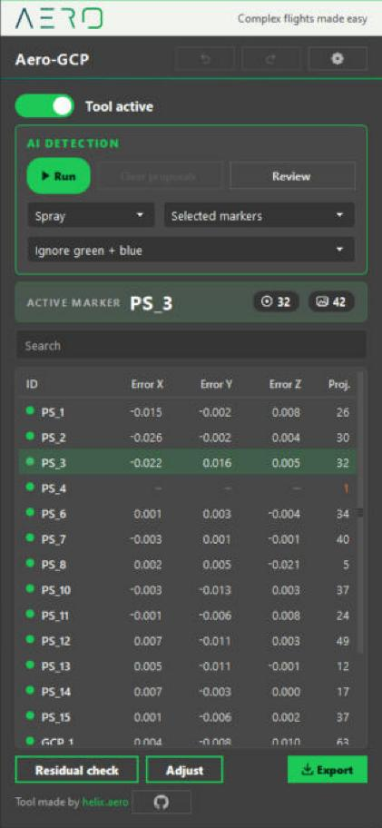

   
  
   
  
   
  Dev = the newest changes, still being tested. Stable = the validated version.

  <a href="https://helix.aero">
    <picture>
      <source media="(prefers-color-scheme: dark)" srcset="assets/logo/helix-aero-AERO-blanc-512px.png">
      
    </picture>
  </a>

<h3 align="center">Complex flights made easy</h3>

  Flight planning for aerial mapping, with drones and crewed aircraft. 
  <a href="https://helix.aero"><b>Discover HELIX Flight Planner</b></a>&nbsp;&nbsp;&nbsp;&middot;&nbsp;&nbsp;&nbsp;<a href="https://helix.aero"><b>Request a demo</b></a>

---

## About HELIX AERO

HELIX AERO is flight planning software for aerial mapping, built by surveyors and engineers in Corsica. We started it from our
own survey work: preparing missions, flying them, and checking the data they produce.

- **HELIX Flight Planner** is a desktop application that turns a polygon into an optimized LiDAR or photogrammetry mission,
  checked before the flight, for drones and crewed aircraft. It calculates on your computer's graphics card, works offline, and
  exports missions for DJI aircraft (MAVLink is coming). It is in early access.
- **HELIX FMS** guides the pilot of a crewed survey aircraft along the planned flight line, on an iPad. It is in beta.

AeroTools, below, is the part of our daily tooling that we share with the Metashape community.

[Discover HELIX Flight Planner →](https://helix.aero)

Contact: François Menassé - info@helix.corsica

---

# AeroTools

**Tools for Agisoft Metashape, made by HELIX AERO. Each one is installed on its own.**

  &nbsp;&nbsp;&nbsp;
  &nbsp;&nbsp;&nbsp;
  

[Tools](#tools) · [Install](#install) · [Requirements](#requirements) · [Development](docs/DEVELOPMENT.md) · [Contributing](CONTRIBUTING.md) · [Third-party notices](THIRD_PARTY.md)

We map with drones and we use Metashape every day. AeroTools is the part of our own tooling that we share. It adds an **Aero**
menu to Metashape, with one entry per tool.

## Tools

| Tool | What it does | Documentation |
|---|---|---|
| **Aero-GCP** | Mark ground control points by hand, or let an AI propose the marks and review them. Check the marking, choose the control markers, export a PDF report. | [Aero-GCP guide](docs/tools/aero-gcp.md) |
| **Aero-Space** | Scan a drive for old Metashape projects, then lighten or delete them to free disk space. | [Aero-Space guide](docs/tools/aero-space.md) |
| **Aero-Exports** | Export the orthomosaic and the DEM with short file names, in several formats, pixel sizes and coordinate systems. | [Aero-Exports guide](docs/tools/aero-exports.md) |

## Install

You need Metashape Pro 2.x on Windows.

1. Click **Download latest stable version** at the top of this page (or **Download latest dev version** to try the newest changes, or clone this repository), and unzip it anywhere you like.
2. Double-click **`CLICK HERE TO INSTALL.bat`** (at the root of the unzipped folder). It installs the **Aero** menu and the code the tools share, and nothing else (a few seconds: about 1 MB on the stable version, about 26 MB on the dev version).
3. Restart Metashape and open **Aero > Install plugins...**: every tool is listed with an **Install** button. Pick the ones you need; each one downloads only its own files
   (a tool that needs another one brings it, and says so). **Aero-GCP** asks which AI detection you want first (none, light, precise or both).
   Tools can be updated or removed from the same window.

Later, **Aero > Check for updates...** brings the latest version of the installed tools from GitHub (with the list of changes and their size).

The installer copies the core to `%LOCALAPPDATA%\HELIX\AeroToolsApp` (the tools you install later go there too) and writes one small launcher
into `%LOCALAPPDATA%\Agisoft\Metashape Pro\scripts\`. Nothing else is touched.
**Aero > Uninstall Aero...** removes the launcher and the downloaded code (and, if you tick them, your settings and the AI environment);
`install\uninstall_aerotools.bat` removes the launcher without Metashape. A development copy (a folder with `.git`) is used where it is: nothing is copied.

## Requirements

- Windows, and Metashape Pro 2.x. We use it daily with Metashape 2.2.
- An internet connection to install the tools and to update them.
- Disk space: all the tools together take about 35 MB (stable version) or about 60 MB (dev version), without the optional AI engines below.
- Aero-GCP, optional AI detection: a separate light Python (ONNX Runtime), about 100 MB, no graphics card needed. A precise engine
  (PyTorch, about 3 GB) and retraining tools (about 3 GB) are optional. Hand marking works without any of them.
  See the [troubleshooting table](docs/tools/aero-gcp.md#troubleshooting) if the detection does not start.

## Status

We use AeroTools on real projects, but only on a few setups so far. Metashape's photo view API is thinly documented, so expect a
few rough edges. The AI detection is recent: we measured it on our own projects, and it works best on the target types it was
trained on.

If something breaks, open an issue and paste the lines from the Log (Settings window). It makes fixing much faster.

## Development

Issues, ideas and pull requests are welcome.

- Fork the repository, work on a branch, and open a pull request against `dev`.
- Code runs in Metashape's embedded Python 3.9 with PySide2, and also under PySide6. No extra dependency, please.
- Run the tests with `python -m pytest tests -q`. They do not need Metashape.
- By sending a pull request you agree that your contribution is released under the same license, and that HELIX AERO may also offer it under other terms, including commercial ones.
- More details in [docs/DEVELOPMENT.md](docs/DEVELOPMENT.md).

## License

[PolyForm Noncommercial 1.0.0](LICENSE). Copyright 2026 HELIX AERO.

The code and the base AI model (`models/checker.pt`, `models/spray.pt`, "Aero V1.0") are open to read, and free to use, modify and share for any non-commercial purpose: personal use, study,
research, teaching, hobby projects, non-profit organizations. Commercial use needs a separate license from us.
If you would like to use AeroTools in a business, get in touch: info@helix.corsica

---

  <a href="https://helix.aero">
    <picture>
      <source media="(prefers-color-scheme: dark)" srcset="assets/logo/helix-aero-AERO-blanc-512px.png">
      
    </picture>
  </a>

<h3 align="center">You mark the control points. Let HELIX plan the flight.</h3>

  Bring a survey area to a video demo and look at the plan together, or try HELIX Flight Planner free for seven days.   
  <a href="https://helix.aero"><b>Discover HELIX Flight Planner</b></a>&nbsp;&nbsp;&nbsp;&middot;&nbsp;&nbsp;&nbsp;<a href="https://helix.aero"><b>Request a demo</b></a>

