# Tutoriel Aero-GCP

[English version](TUTORIAL.md)

Aero-GCP est le premier outil d'AeroTools, la petite boîte à outils que nous écrivons chez [HELIX AERO](https://helix.aero) pour
Agisoft Metashape. Il sert à pointer rapidement les points de calage au sol (GCP). Il peut aussi proposer lui-même les pointés
avec un détecteur IA : vous les passez en revue, vous les corrigez et, si vous le voulez, vous réentraînez le modèle sur vos
propres corrections.

Ce tutoriel suit l'ordre dans lequel vous allez vous en servir. Les noms de boutons sont écrits comme dans l'interface française.

- [1. Installer et démarrer](#1-installer-et-démarrer)
- [2. Pointer les GCP à la main](#2-pointer-les-gcp-à-la-main)
- [3. La liste des marqueurs](#3-la-liste-des-marqueurs)
- [4. Laisser l'IA proposer les pointés](#4-laisser-lia-proposer-les-pointés)
- [5. Le Review panel](#5-le-review-panel)
- [6. La fenêtre d'affinage](#6-la-fenêtre-daffinage)
- [7. Le rapport PDF](#7-le-rapport-pdf)
- [8. Paramètres et modèles IA](#8-paramètres-et-modèles-ia)
- [9. Dépannage](#9-dépannage)

## 1. Installer et démarrer

Il faut Metashape Pro 2.x sous Windows. Nous l'utilisons tous les jours avec Metashape 2.2.

1. Récupérez ce dépôt (téléchargement ou clone) et posez-le où vous voulez, par exemple sur un disque partagé.
2. Double-cliquez sur `CLICK HERE TO INSTALL.bat` (à la racine ; il lance `install\installer_aerotools.bat`). Cet installeur unique met aussi en place la détection IA (environ 100 Mo, une seule fois, avec un affichage « Please wait... »). Il écrit un petit lanceur dans
   `%LOCALAPPDATA%\Agisoft\Metashape Pro\scripts\` et ne touche à rien d'autre.
3. Redémarrez Metashape. Un menu **Aero** apparaît.
4. Ouvrez **Aero > Aero-GCP** (raccourci **F8**). Le panneau s'accroche à droite de la fenêtre.

**Aero > Recharger AeroTools** relit le code sans redémarrer Metashape. `install\desinstaller_aerotools.bat` retire le lanceur.

> **Note.** La détection IA tourne dans un Python séparé et léger (ONNX Runtime, environ 100 Mo) : l'installeur le met en place (le
> même installeur, relancez-le si besoin). Les modèles `models\damier.onnx` et `models\bombe.onnx` (et leurs poids sources `.pt`) sont
> fournis avec le téléchargement. Le réentraînement (« Affiner mon modèle ») demande en plus `torch` (environ 3 Go) : lancez une fois
> `install\installer_entrainement.bat`. Voir le [dépannage](#9-dépannage). Tout le reste fonctionne sans eux.

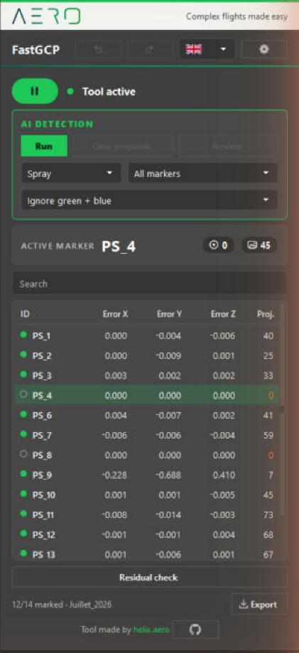

## 2. Pointer les GCP à la main

L'en-tête du panneau porte le titre, un bouton Annuler, la liste des langues et l'engrenage des **paramètres**. Dessous, le bouton
rond **Play / Pause** montre l'état de l'outil : **Tool actif** ou **Tool inactif**. Quand l'outil est en pause, Metashape se
comporte comme d'habitude.

Pour pointer un marqueur :

1. Choisissez un marqueur dans la liste du panneau, ou dans le panneau Reference de Metashape. Les deux restent synchronisés.
2. Le panneau Photos se filtre sur les photos qui voient ce marqueur, et la vue photo zoome autour de lui.
3. Cliquez sur la cible dans la vue photo. Le point est posé exactement là où vous avez cliqué. Un simple clic gauche suffit ;
   Maj + clic et **Ctrl+Maj+M** (point sous le curseur) marchent aussi.
4. La photo suivante qui voit le marqueur et n'a pas encore de point s'ouvre toute seule. Cliquez à nouveau.

**Ctrl+Z**, ou le bouton Annuler de l'en-tête, reprend le dernier point. Aero-GCP garde les 100 derniers. **Ctrl+Y** ou **Ctrl+Maj+Z** le remet.

> **Note.** Si la vue photo est déjà zoomée, Aero-GCP garde votre zoom et se contente de recentrer sur le marqueur. Sur une photo
> encore ajustée à la fenêtre, il montre environ 400 pixels autour du marqueur (réglage caché `zoom_fenetre_px`, voir
> [DEVELOPMENT.md](DEVELOPMENT.md)).

## 3. La liste des marqueurs

Le tableau liste les marqueurs du chunk courant : **ID**, **Erreur X**, **Erreur Y**, **Erreur Z** (en mètres, position estimée
moins référence) et **Proj.** (photos où le marqueur est posé). Cliquez sur un en-tête pour trier : croissant, décroissant, puis
retour à l'ordre du projet. Le champ **Rechercher** filtre par nom. La ligne d'état compte les marqueurs qui ont au moins
3 photos pointées (`12/40 pointés`).

La carte du **marqueur actif** tient sur une ligne : le nom du marqueur (coupé après 10 caractères, puis trois points), le nombre
de photos où il est posé et le nombre de photos qui le voient.

**Sélectionner plusieurs marqueurs.** **Maj + clic** sélectionne une plage, **Ctrl + clic** ajoute ou retire un marqueur. Le
dernier marqueur cliqué reste le marqueur actif. Cette sélection est ce que veut dire **Marqueurs sélectionnés** dans la carte IA
(section 4).

**Supprimer des projections ou des marqueurs.** Clic droit sur la sélection :

| Entrée du menu | Effet |
|---|---|
| **Supprimer les projections (n)** | Retire toutes les projections des marqueurs sélectionnés (posées à la main, calculées par Metashape, propositions de l'IA). Les marqueurs restent dans le projet. |
| **Supprimer les marqueurs (n)** | Supprime les marqueurs sélectionnés du projet. |

Les deux demandent une confirmation, et **Aero-GCP ne peut pas rétablir un marqueur supprimé**. Enregistrez votre projet avant.

**Contrôle des résidus.** Le bouton sous le tableau liste les marqueurs à surveiller : ceux dont le résidu est élevé (au-dessus du
plus grand des deux : 3 cm ou trois fois la médiane basse des erreurs du chunk) et ceux qui ont moins de 3 photos pointées.
Cliquez sur une entrée pour ouvrir la pire photo du marqueur.

**Export.** Le bouton **Exporter** écrit un **Rapport PDF** ou un **Tableau CSV** (section 7).

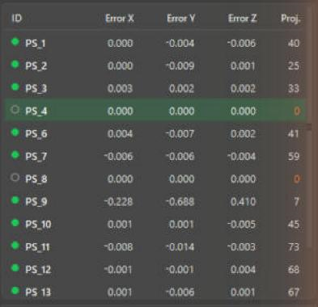

## 4. Laisser l'IA proposer les pointés

La carte **Détection IA** est en haut du panneau. Elle a un bouton vert **Lancer**, **Effacer les propositions** et **Réviser**, et
trois listes :

| Liste | Choix |
|---|---|
| Type de cible | **Damier** (damier 2×2) ou **Bombe** (marque à la bombe ou à la craie). Les deux modèles ne se mélangent jamais. |
| Portée | **Marqueurs sélectionnés** (le marqueur actif, ou tous ceux que vous avez sélectionnés avec Maj ou Ctrl) ou **Tous les marqueurs** (tout marqueur qui a une position 3D ; aucun point posé n'est exigé quand le marqueur a des coordonnées de référence). |
| Photos à laisser tranquilles | **Ignore vert + bleu**, **Ignore vert** (points posés à la main), **Ignore bleu** (points calculés par Metashape) ou **Ignore rien**. |

Vos choix sont mémorisés sur ce poste.

Cliquez sur **Lancer**. Une barre de progression montre les photos traitées. Le calcul tourne dans un processus séparé : Metashape
reste utilisable.

Ce que vous obtenez :

- Une **proposition** est un point non épinglé. Elle ne compte pas comme une photo pointée et ne remplace jamais un point que vous
  avez posé. Cliquer sur la cible la remplace par un point normal.
- Deux contrôles écartent les détections douteuses, et la ligne d'état les compte comme *rejetées par le garde-fou*. D'abord une
  détection trop éloignée de l'endroit où les autres projections du marqueur disent qu'il devrait être (un toit, un arbre).
  Ensuite, les détections d'une même cible doivent se recouper en un seul point 3D.
- **Effacer les propositions** retire toutes les propositions pas encore validées et remet le point qui était là avant. Les
  points bleus de Metashape ne sont jamais touchés.

> **Note.** Une proposition non validée déplace la position estimée du marqueur dans Metashape. Validez les propositions ou
> effacez-les avant de vous fier aux erreurs du tableau.

Quand la détection se termine, le Review panel s'ouvre tout seul (réglage *Ouvrir le Review panel automatiquement*, activé par
défaut). **Réviser** le rouvre.

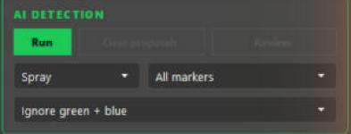

## 5. Le Review panel

Les marqueurs qui ont des propositions sont à gauche (`PS_1   40/41` : propositions encore gardées sur le total du marqueur). Au
milieu, une vignette par photo : un recadrage autour du point proposé, une croix rouge dessus, la confiance dans le coin et le nom
de la photo dessous.

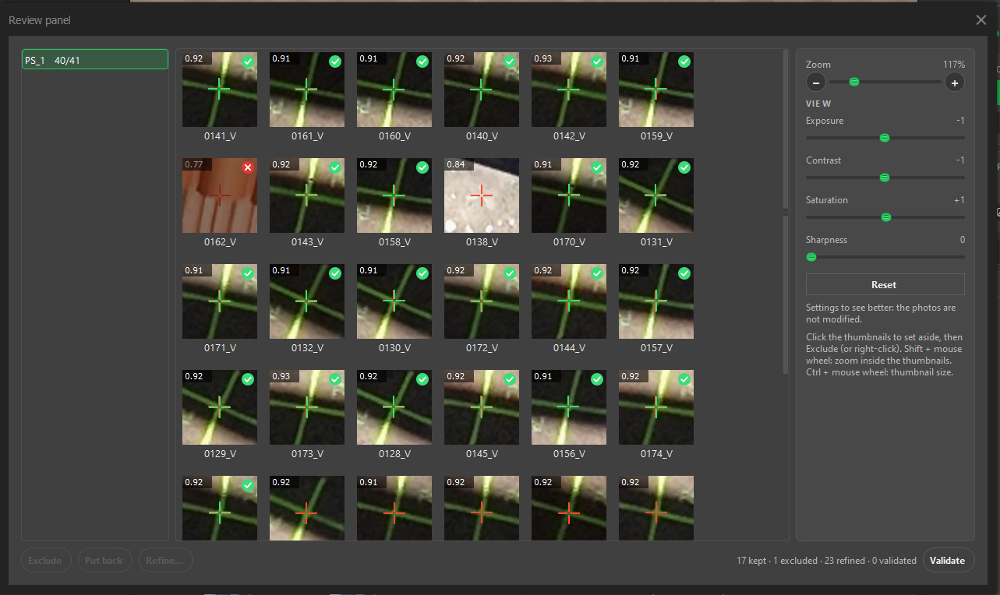

**On sélectionne, puis on agit.** Un clic sélectionne une vignette, un autre clic la désélectionne. Cliquez toutes les mauvaises,
sans Ctrl. Ensuite :

| Bouton | Raccourci | Effet |
|---|---|---|
| **Exclure** | Suppr, ou clic droit | Retire la proposition du projet tout de suite ; le point d'avant revient. Marche aussi après **Valider** et sur les points affinés : l'outil demande d'abord, puis défait ce pointage manuel. **Remettre** le rétablit tel qu'il était. |
| **Remettre** | clic droit | Annule une exclusion. |
| **Affiner…** | Entrée, double-clic, ou clic droit | Ouvre les vignettes sélectionnées dans la fenêtre d'affinage (section 6). |
| **Valider** | | Transforme chaque proposition gardée en point manuel, après confirmation. |

Les boutons sont grisés quand ils n'ont rien à faire.

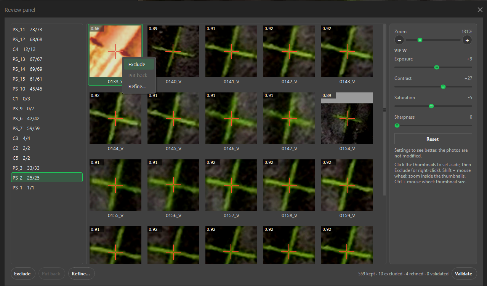

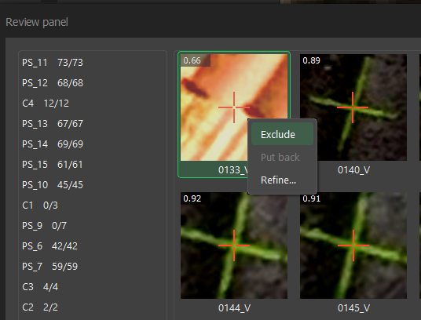

**Valider** ouvre une petite fenêtre d'attente avec une barre de progression pendant la pose des points : un second clic ne peut
donc pas lancer un second passage. Quand c'est fini, et après chaque exclusion ou affinage, le tableau des marqueurs du panneau est
relu (erreurs X, Y, Z et nombre de projections).

<!-- TODO screenshot: validate-busy.png (la petite fenêtre « Application en cours » avec sa barre de progression) -->

**Pastilles de statut.** Une petite pastille en haut à droite de chaque vignette donne son état, et l'infobulle le dit en toutes
lettres :

| Pastille | État |
|---|---|
| aucune | gardée (une proposition, pas encore validée) |
| croix rouge, vignette assombrie | **exclue** |
| coche verte | **affinée** (posée à la main dans la fenêtre d'affinage) |
| coche creuse | **validée** telle qu'elle était proposée |

La ligne du bas les compte : `17 gardés · 1 exclus · 23 affinés · 0 validés`.

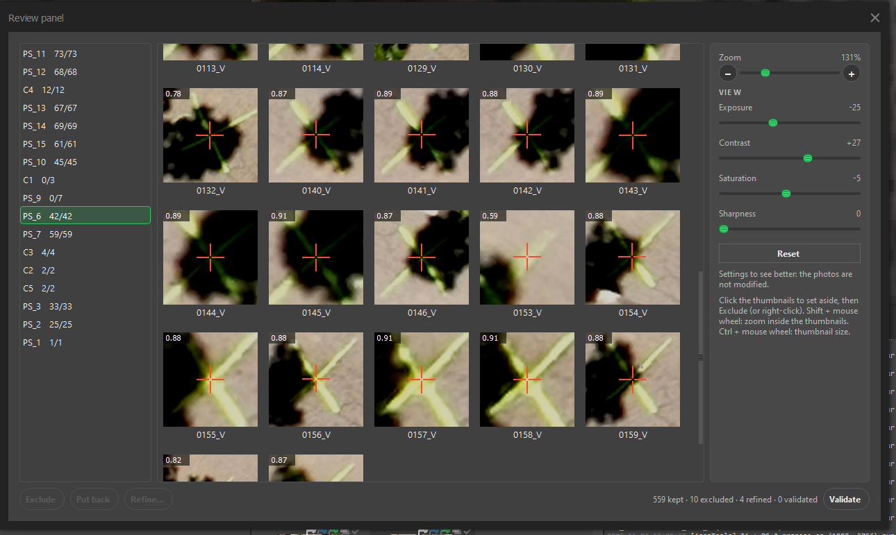

### Le panneau de droite

- **Zoom** (le curseur et les boutons **+** et **−**) zoome *dans* les vignettes : plus ou moins de contexte autour du point,
  de 50 % à 400 %. **Maj + molette** fait pareil. **Ctrl + molette** agrandit ou réduit les vignettes elles-mêmes.
- **Affichage** a quatre curseurs : **Exposition**, **Contraste**, **Saturation** et **Netteté**. Ils aident l'œil, rien de plus. Les
  photos, les recadrages et les points ne sont jamais modifiés. Les mêmes valeurs s'appliquent dans la fenêtre d'affinage, et
  Aero-GCP s'en souvient. Un **double-clic** sur un curseur (ou sur son nom ou sa valeur) le remet à 0 ; **Réinitialiser** remet
  les quatre à zéro.

| Avant | Après |
|---|---|
| 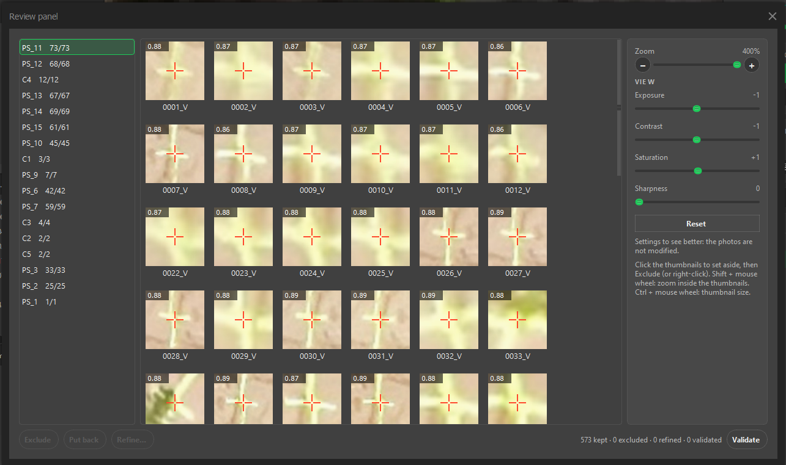 | 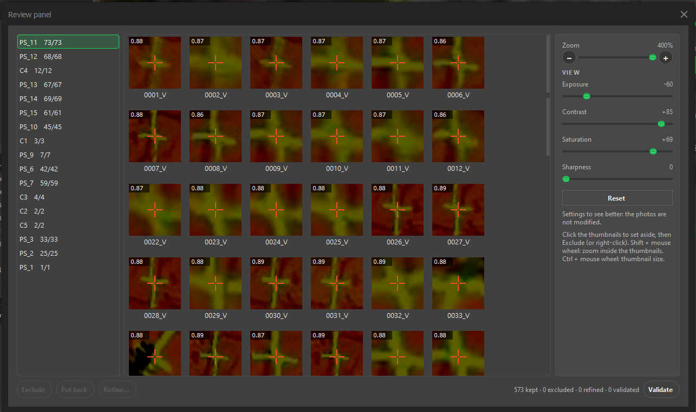 |

> **Note.** Les curseurs d'Affichage ont besoin de numpy, livré avec Metashape. Sans lui ils sont désactivés et le panneau le dit.

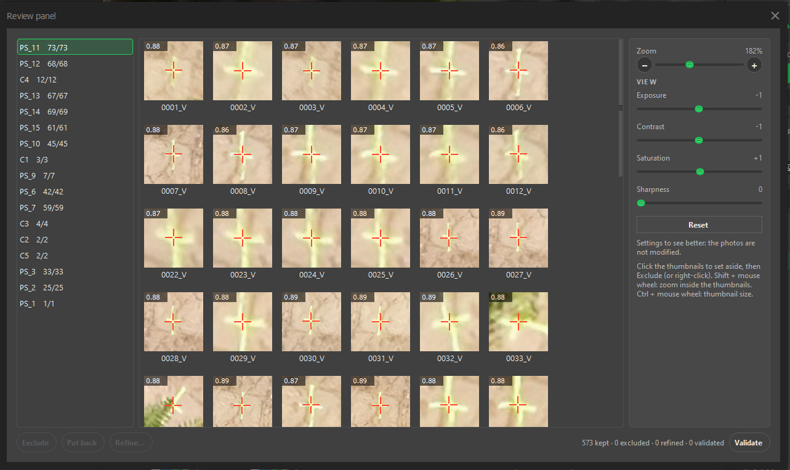

## 6. La fenêtre d'affinage

Sélectionnez des vignettes et cliquez sur **Affiner…** (ou Entrée, ou double-clic sur l'une d'elles). Une grande fenêtre s'ouvre
avec toutes les photos sélectionnées, une à la fois. Le titre indique *Affiner le marqueur PS_11 sur DJI_…* et l'en-tête donne le
numéro de la photo.

- Cliquez, ou glissez, sur le vrai centre de la cible. Une croix verte montre votre pointé ; la croix rouge est la proposition de
  l'IA.
- La **molette** zoome autour du curseur. Le **bouton du milieu** déplace l'image.
- Les curseurs du Review panel sont à droite et restent synchronisés avec lui.
- Une barre en bas compte les pointés (`3/15 pointées`). **Suivant** (ou Entrée) passe à la prochaine photo sans pointé.
- **Annuler** ne pose rien. **Valider et quitter** pose les pointés faits. Quand toutes les photos sont pointées, il devient vert
  et s'appelle **Valider**.

Les points ne sont posés qu'à la validation. Chacun devient un point manuel, et Ctrl+Z le défait. Une vignette déjà affinée ou
validée peut être affinée à nouveau.

De retour dans le Review panel, une vignette affinée montre votre croix verte et une coche verte en haut à droite, et la ligne du bas la compte parmi les affinés :

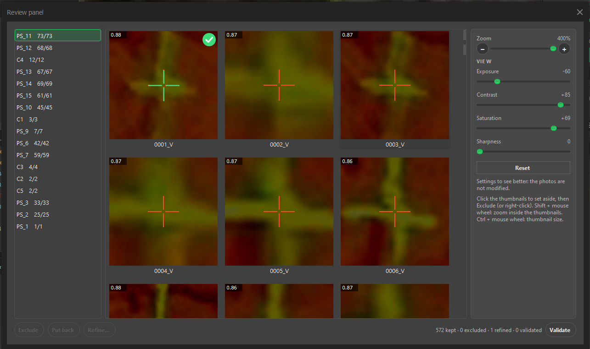

<!-- TODO screenshot: refine-window.png (la fenêtre d'affinage avec la barre n/N et le bouton Valider vert) -->

## 7. Le rapport PDF

**Exporter > Rapport PDF** écrit un rapport du chunk courant : chiffres clés, graphiques d'erreurs, tableau des marqueurs et
captures d'écran. Si vous avez lancé une détection IA pendant la session, une section *Photos pointées par l'IA* suit :

- un bloc par marqueur, avec un résumé des erreurs, l'écart de pointage en pixels, la confiance de l'IA, et si le marqueur sert de
  GCP ou seulement de point de contrôle ;
- une vignette par photo, avec la croix rouge et la confiance dessous (les photos affinées disent *manuel*) ;
- **les photos exclues aussi**, assombries et barrées d'une grande croix rouge, comptées dans l'en-tête du marqueur et laissées hors
  de ses statistiques.

Les propositions que vous avez effacées, et les affinages défaits avec Ctrl+Z, sont laissés de côté. Chaque pied de page renvoie
vers [helix.aero](https://helix.aero). **Exporter > Tableau CSV** écrit le tableau des marqueurs (ID, erreurs, projections,
coordonnées de référence).

<!-- TODO screenshot: report-ai-page.png (une page du PDF avec une photo exclue) -->

## 8. Paramètres et modèles IA

L'**engrenage** de l'en-tête ouvre la fenêtre Paramètres.

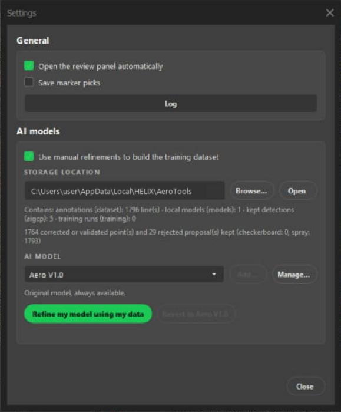

**Général**

- *Ouvrir le Review panel automatiquement* après une détection.
- *Enregistrer les pointages* : ajoute chaque clic manuel (chemin de la photo, position, marqueur) à un fichier dans un dossier
  visible, pour un futur entraînement. Aucune image n'est copiée.
- **Journal** : le journal de l'outil. Si quelque chose casse, collez ses dernières lignes dans une issue.

**Mises à jour**

**Rechercher les mises à jour…** (aussi dans le menu **Aero**) ouvre la liste des modules installés avec leur version et la date de
la dernière mise à jour. Elle interroge GitHub et dit, pour chacun, combien de fichiers ont changé et combien il y a à télécharger.
Clique sur **Mettre à jour** sur la ligne, ou sur **Tout mettre à jour** en bas à droite. Ne ferme pas la fenêtre pendant ce temps :
chaque fichier est d'abord téléchargé et vérifié, puis remplacé (si quelque chose échoue, les anciens fichiers sont remis), puis les
fichiers installés sont relus pour confirmer. À la fin AeroTools se recharge tout seul, sans redémarrer Metashape. Les nouvelles
entrées du menu Aero, s'il y en a, apparaissent au démarrage suivant. Une copie de développement (un dossier avec `.git`) n'est
jamais mise à jour : rien n'est écrasé.

**Moteur de détection**

- **Léger** : ONNX Runtime sur le processeur, environ 100 Mo, tout ordinateur. **Précis** : le moteur d'origine (PyTorch, environ
  3 Go), carte graphique utilisée s'il y en a une. **Automatique** prend le précis s'il est installé, sinon le léger. Sur notre
  test (569 cibles), les deux placent 99 % des cibles à moins de 0,05 px l'une de l'autre.
- Les trois lignes dessous disent ce qui est installé (*Moteur léger*, *Moteur précis*, *Outils de réentraînement*). Quand
  quelque chose manque, **Installer** le fait à ta place : une fenêtre noire montre l'avancement (ne la ferme pas), puis la ligne
  passe à *installé*. C'est pareil si tu lances une détection ou un réentraînement sans ce qu'il faut : une boîte propose de
  l'installer.

**Modèles IA**

- *Utiliser mes affinages manuels pour construire le jeu d'entraînement* : cochée, chaque décision prise dans le Review panel
  (exclure, affiner, valider) est enregistrée dans `aigcp_feedback.jsonl`. Décochée, rien n'est enregistré.
- **Dossier de stockage** et **Parcourir…** : le dossier qui contient ce fichier et vos propres modèles. Par défaut
  `%LOCALAPPDATA%\HELIX\AeroTools`. Une ligne dessous compte ce qui est enregistré.
- **Modèle IA** : **Aero V1.0** est le nôtre, toujours présent. Les modèles que vous entraînez s'appellent **Local 1.1**,
  **Local 1.2**… et ne se renomment pas. **Gérer…** supprime les modèles locaux ; Aero V1.0 ne peut pas être supprimé.
  **Ajouter…** est grisé pour l'instant.
- **Affiner mon modèle avec mes données** réentraîne le détecteur sur vos annotations. **Revenir à Aero V1.0** rétablit le modèle
  d'origine à tout moment.

### Ce que fait le réentraînement

Cliquez sur **Affiner mon modèle avec mes données**. Aero-GCP affiche d'abord un avertissement qui dit :

- le modèle peut mieux fonctionner sur vos cibles, et moins bien sur d'autres ;
- ce que vous avez classé en spray est appris comme du spray, ce que vous avez classé en damier comme du damier : des erreurs dans
  vos annotations donnent un résultat moins bon ;
- la carte graphique est fortement sollicitée pendant un moment, donc ne touchez pas à l'ordinateur ;
- votre modèle d'origine n'est jamais modifié.

L'entraînement repart des poids d'origine à chaque fois, avec toutes vos décisions enregistrées : les erreurs d'un essai ne
s'accumulent pas. Pour chaque type de cible, il construit de petits recadrages autour de vos points corrigés et validés
(positifs), autour des propositions que vous avez rejetées (négatifs), et quelques fonds. Il met des cibles de côté pour vérifier
le résultat. Un type demande au moins 30 exemples positifs ; en dessous il est ignoré et le modèle local garde les poids
d'origine pour lui. Une barre de progression suit les époques et **Annuler** l'arrête proprement.

À la fin, le nouveau modèle **Local** est sélectionné et vous pouvez l'essayer sur votre prochaine détection. S'il fait nettement
moins bien qu'Aero V1.0 sur les données mises de côté, la fenêtre vous le dit. Utilisez **Revenir à Aero V1.0** si vous préférez.

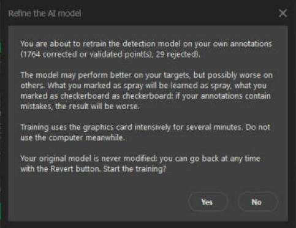

> **Note : ce que nous avons mesuré.** Un essai sur notre propre projet, type Bombe uniquement : 798 exemples positifs et 208
> négatifs, 75 secondes sur une carte graphique RTX 4070. Sur les cibles mises de côté, le mAP50 était de 0,9762 pour le nouveau
> modèle et de 0,9784 pour Aero V1.0. La différence n'est pas mesurable : ce n'est pas une amélioration. Le réentraînement est
> une expérience : nous ne promettons pas qu'il améliore la détection. Essayez le nouveau modèle sur un projet que vous connaissez,
> et cliquez sur **Revenir à Aero V1.0** s'il ne fait pas mieux.

### Le diagnostic complet

Sous la liste des marqueurs, le bouton **Contrôle des résidus** liste les marqueurs à surveiller. Sa dernière ligne, **Diagnostic complet du
pointage…**, ouvre une fenêtre qui va plus loin. Pour chaque pointage manuel (point vert), elle recalcule la position 3D du marqueur
**sans cette photo**, la reprojette et dit à combien de pixels elle tombe de ton pointage. Quelques pixels, c'est normal. Elle liste les
pointages douteux (écart de plus de 3 px, ou 4 fois la médiane du projet), les photos décalées sur plusieurs marqueurs, et les
marqueurs qui ont trop peu de pointages ou des propositions de l'IA pas encore validées. Double-clique une ligne pour ouvrir la photo,
zoomée sur le marqueur. Un pointage très décalé fait paraître ses voisins fautifs : on met donc le pire de côté et on rejuge les
autres, jusqu'à ce que plus rien ne dépasse.

## 9. Dépannage

| Symptôme | À vérifier |
|---|---|
| Le menu **Aero** manque | Double-cliquez à nouveau sur `CLICK HERE TO INSTALL.bat` et redémarrez Metashape. |
| *IA : Python d'AIGCP introuvable*, ou une boîte *Installation de la détection IA* | Le détecteur tourne dans son propre Python léger (ONNX Runtime). Le plus simple : double-cliquez à nouveau sur `CLICK HERE TO INSTALL.bat` (il installe tout, environ 100 Mo). Par défaut Aero-GCP cherche `%USERPROFILE%\AIGCP\_env\Scripts\python.exe` ; définissez la variable d'environnement `AIGCP_PYTHON`, ou la clé `python` de la section `aigcp` de `settings.json`, pour en utiliser un autre. |
| *IA : poids … introuvables* | Les deux fichiers `damier.pt` et `bombe.pt` doivent être dans le dossier `models` du téléchargement : remettez-les-y si vous les avez supprimés, ou définissez `models_dir` dans la section `aigcp`. |
| L'IA ne trouve rien | Vérifiez que le marqueur a une position 3D ou des coordonnées de référence, que les photos sont alignées, et que la liste *Ignorer* ne cache pas les photos voulues. |
| Une photo est introuvable ou illisible | Le détecteur lit les fichiers image d'origine, au chemin que Metashape connaît. Vérifiez que le disque ou le partage est connecté. |
| *Réglages indisponibles (numpy absent)* | Les curseurs d'Affichage ont besoin de numpy. Metashape le livre normalement. |
| *Entraînement impossible* | Ouvrez la fenêtre Paramètres puis **Journal**. Le message dit s'il manque l'environnement Python, le script ou les données. |
| Autre chose casse | Ouvrez le Journal, copiez les dernières lignes et ouvrez une issue. |

Les réglages du poste sont dans `%LOCALAPPDATA%\HELIX\AeroTools\settings.json`. Les notes pour les développeurs sont dans
[DEVELOPMENT.md](DEVELOPMENT.md).

AeroTools est fait par [HELIX AERO](https://helix.aero). Code source : [github.com/helix-aero/AeroTools](https://github.com/helix-aero/AeroTools).

## 10. Aero-Space : libérer de la place

**Aero > Aero-Space** ouvre une fenêtre qui trouve les anciens projets Metashape qui mangent ton disque. Choisis un disque (ou
**Dossier…**) et clique **Scanner** : les projets les plus lourds arrivent en premier. Pour chacun tu vois le fichier `.psx`, les
trois dossiers au-dessus (pour reconnaître le chantier), **Dense + profondeur** (ce que libère l'allègement, en Go), **Projet entier**
(pour juger si le supprimer vaut la peine), **Gardés** (les fichiers à côté du projet que la suppression ne touche pas, voir
plus bas), la part de l'un dans l'autre, la date et l'état (*Ouvert*, *Ancien verrou* laissé par un
plantage, ou dossier `.files` orphelin dont le `.psx` a disparu). Clique un en-tête pour trier. Survole la taille pour le détail
(nuage dense, cartes de profondeur, points de liaison, MNT, orthos). Coche les projets, puis :

- **Alléger (doux)** retire le nuage dense et les cartes de profondeur, qui se recalculent. L'alignement, les marqueurs, les MNT et
  les orthos restent, et Metashape ouvre et enregistre chaque projet pour qu'il reste cohérent.
- **Supprimer le projet** retire le `.psx` et son dossier `.files`, rien d'autre. Les fichiers exportés à côté du projet (ortho,
  MNT, nuages, rapports, dans le même dossier ou un niveau plus bas) ne sont pas touchés : la colonne **Gardés** les compte, et
  le survol donne les plus gros. Un signe d'avertissement veut dire que le projet contient un MNT ou une ortho construits dans
  Metashape et qu'aucun fichier exporté (tif, ecw, las, dxf…) n'a été trouvé à côté : ils sont dans le `.files` et partiraient
  avec le projet, donc exporte-les d'abord si tu en as besoin.

**Supprimer le projet** demande où ça part : **Corbeille** (restaurable, la place n'est libérée qu'en la vidant, indisponible sur un
lecteur réseau) ou **Supprimer définitivement**, qui demande de taper `DELETE`. **Alléger** est toujours définitif et demande
toujours de taper `DELETE` : Metashape efface lui-même ces fichiers quand il enregistre le projet, il n'y a donc pas de corbeille. Un projet ouvert dans un Metashape (même sur un autre
ordinateur) n'est jamais touché. Chaque action est écrite dans un journal (bouton **Journal des actions**).

**Teste d'abord sur une copie.** Copie un petit projet (le `.psx` et son dossier `.files`) dans un dossier de test, scanne ce
dossier, et essaie les deux modes sur la copie avant de l'utiliser sur du vrai travail.
