# Aero-GCP tutorial

[Version française](TUTORIAL.fr.md)

Aero-GCP is the first tool of AeroTools, the small suite we write at [HELIX AERO](https://helix.aero) for Agisoft Metashape.
It marks ground control points (GCPs) quickly, and it can propose the marks itself with an AI detector that you review, correct
and, if you want, retrain on your own corrections.

This tutorial follows the order you will use it in. Every button name is written as it appears in the English interface.

- [1. Install and start](#1-install-and-start)
- [2. Mark GCPs by hand](#2-mark-gcps-by-hand)
- [3. The marker list](#3-the-marker-list)
- [4. Let the AI propose the marks](#4-let-the-ai-propose-the-marks)
- [5. The Review panel](#5-the-review-panel)
- [6. The Refine window](#6-the-refine-window)
- [7. The PDF report](#7-the-pdf-report)
- [8. Settings and AI models](#8-settings-and-ai-models)
- [9. Troubleshooting](#9-troubleshooting)

## 1. Install and start

You need Metashape Pro 2.x on Windows. We use it daily with Metashape 2.2.

1. Get this repository (download or clone it) and put it anywhere, for example on a shared drive.
2. Double-click `CLICK HERE TO INSTALL.bat` (at the root; it runs `install\installer_aerotools.bat`). This single installer also sets up the AI detection (about 100 MB, once, with a "Please wait..." display). It writes one small launcher into
   `%LOCALAPPDATA%\Agisoft\Metashape Pro\scripts\` and touches nothing else.
3. Restart Metashape. A new **Aero** menu appears.
4. Open **Aero > Aero-GCP** (shortcut **F8**). The panel docks on the right of the window.

**Aero > Reload AeroTools** re-reads the code without restarting Metashape. `install\desinstaller_aerotools.bat` removes the launcher.

> **Note.** The AI detection runs in a separate light Python (ONNX Runtime, about 100 MB): the installer sets it up (the same
> installer, run it again if needed). The models `models\damier.onnx` and `models\bombe.onnx` (and their `.pt` source weights) come with
> the download. Retraining ("Refine my model") also needs `torch` (about 3 GB): run `install\installer_entrainement.bat` once.
> See [Troubleshooting](#9-troubleshooting). Everything else works without them.

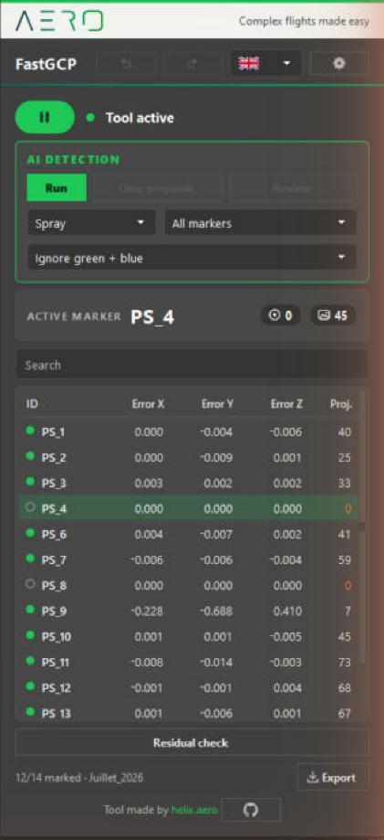

## 2. Mark GCPs by hand

The panel header has the title, an undo button, the language list and the **settings** gear. Under it, the round
**Play / Pause** button shows the state of the tool: **Tool active** or **Tool inactive**. When the tool is paused,
Metashape behaves as usual.

To mark a marker:

1. Pick a marker in the list of the panel, or in Metashape's Reference pane. Both stay in sync.
2. The Photos pane filters itself to the photos that see this marker, and the photo view zooms on the area around it.
3. Click on the target in the photo view. The point is placed exactly where you clicked. A plain left click is enough;
   Shift+click and **Ctrl+Shift+M** (point under the cursor) work too.
4. The next photo that sees the marker and has no point yet opens by itself. Click again.

**Ctrl+Z**, or the undo button in the header, takes back the last point. Aero-GCP keeps the last 100. **Ctrl+Y** or
**Ctrl+Shift+Z** puts it back.

> **Note.** If the photo view is already zoomed, Aero-GCP keeps your zoom and only re-centres on the marker. On a photo that is
> still fitted to the window, it shows about 400 pixels around the marker (hidden setting `zoom_fenetre_px`, see
> [DEVELOPMENT.md](DEVELOPMENT.md)).

## 3. The marker list

The table lists every marker of the current chunk: **ID**, **Error X**, **Error Y**, **Error Z** (metres, estimated position
minus reference) and **Proj.** (photos where the marker is placed). Click a column header to sort: ascending, descending, then
back to the project order. The **Search** box filters by name. The status line counts the markers that have at least
3 placed photos (`12/40 marked`).

The **active marker** card is a single line: the marker name (cut after 10 characters, then three dots), the number of photos
where it is placed and the number of photos that see it.

**Select several markers.** **Shift+click** selects a range, **Ctrl+click** adds or removes one. The last marker you clicked
stays the active marker. The selection is what **Selected markers** means in the AI card (section 4).

**Remove projections or markers.** Right-click the selection:

| Menu entry | What it does |
|---|---|
| **Remove projections (n)** | Removes every projection of the selected markers (placed by hand, computed by Metashape, AI proposals). The markers stay in the project. |
| **Remove markers (n)** | Deletes the selected markers from the project. |

Both ask for confirmation first, and **Aero-GCP cannot bring deleted markers back**. Save your project before using them.

**Residual check.** The button under the table lists the markers to watch: those with a high residual (above the larger of
3 cm and three times the low median of the chunk's errors) and those with fewer than 3 placed photos. Click an entry to open
the worst photo of that marker.

**Export.** The **Export** button writes a **PDF report** or a **CSV table** (section 7).

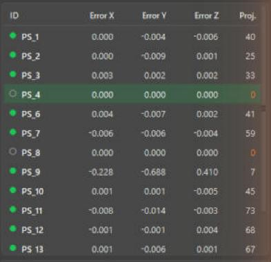

## 4. Let the AI propose the marks

The **AI detection** card sits at the top of the panel. It has a green **Run** button, **Clear proposals** and **Review**, and
three lists:

| List | Choices |
|---|---|
| Target type | **Checker** (2x2 checkerboard) or **Spray** (paint or chalk mark). The two models are never mixed. |
| Scope | **Selected markers** (the active marker, or all the markers you selected with Shift or Ctrl) or **All markers** (every marker that has a 3D position; no placed point is needed when the marker has reference coordinates). |
| Photos to leave alone | **Ignore green + blue**, **Ignore green** (hand-placed points), **Ignore blue** (points computed by Metashape) or **Ignore none**. |

Your choices are remembered on this machine.

Click **Run**. A progress bar shows the photos done. The calculation runs in a separate process, so Metashape stays usable.

What you get:

- A **proposal** is a point that is not pinned. It does not count as a placed photo, and it never replaces a point you placed.
  Clicking on the target replaces it with a normal point.
- Two checks reject doubtful detections, and the status line counts them as *rejected by the guard*. First, a detection too far
  from where the marker's other projections say it should be (a roof, a tree). Second, detections of one target must meet at
  a single 3D point.
- **Clear proposals** removes every proposal that is not validated yet and puts back the point that was there before. It never
  touches Metashape's own blue points.

> **Note.** An unvalidated proposal moves the marker's estimated position in Metashape. Validate the proposals or clear them
> before trusting the errors in the table.

When the detection ends, the Review panel opens by itself (setting *Open the review panel automatically*, on by default). Use
**Review** to reopen it.

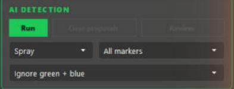

## 5. The Review panel

Markers with proposals are on the left (`PS_1  40/41  ·  62 %`: proposals still kept out of the marker's total, then the
weakest confidence of the marker). **The most doubtful markers come first**, and inside a marker the least sure photos come
first, so you check the risky ones before the obvious ones. In the middle, one thumbnail per photo: a crop around the proposed point, a red cross on it, the confidence in the corner and the photo name
below.

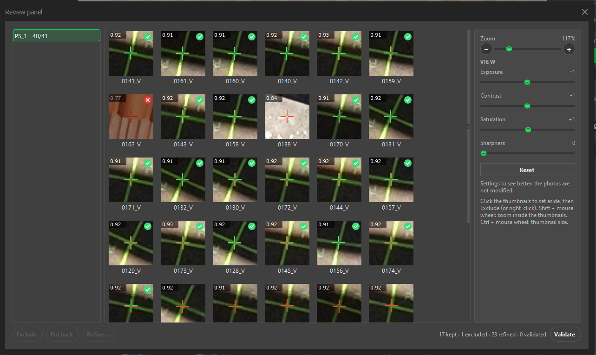

**Select, then act.** A click selects a thumbnail, another click unselects it. Click all the bad ones, no Ctrl needed. Then:

| Button | Shortcut | What it does |
|---|---|---|
| **Exclude** | Delete, or right-click | Takes the proposal out of the project now; the previous point comes back. It also works after **Validate** and on refined points: the app asks first, then undoes that manual point. **Put back** restores it as it was. |
| **Put back** | right-click | Undoes an exclusion. |
| **Refine…** | Enter, double-click, or right-click | Opens the selected thumbnails in the Refine window (section 6). |
| **Validate** | | Turns every kept proposal into a manual point, after a confirmation. |

The buttons are grey when they have nothing to act on.

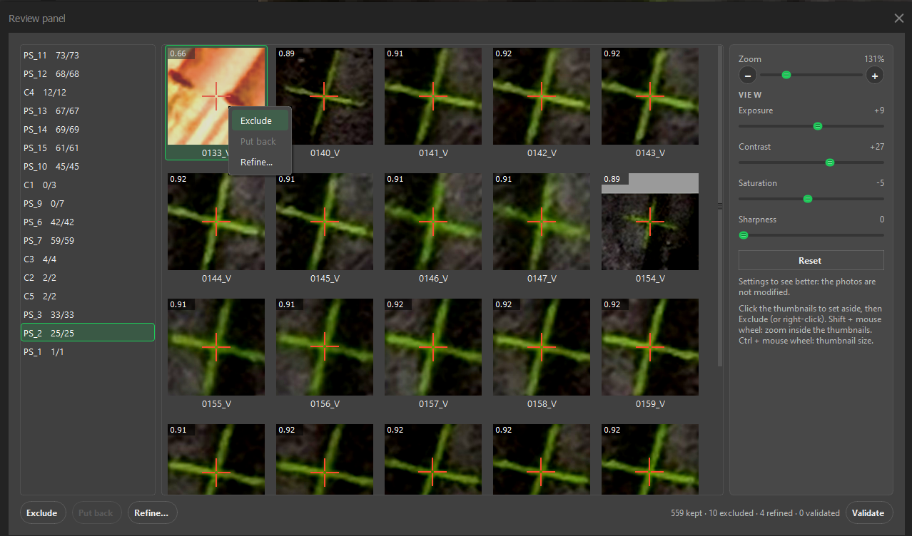

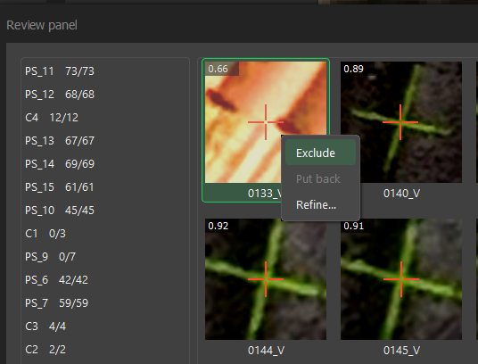

**Validate** shows a small waiting window with a progress bar while the points are placed, so a second click cannot start a second
run. When it is done, and after every exclusion or refinement, the marker table of the panel is read again (errors X, Y, Z and
projection counts).

<!-- TODO screenshot: validate-busy.png (the small "Applying changes" window with its progress bar) -->

**Status tags.** A small tag in the top-right corner of each thumbnail shows its state, and the tooltip says it in words:

| Tag | State |
|---|---|
| none | kept (a proposal, not validated yet) |
| red cross, thumbnail dimmed | **excluded** |
| green check | **refined** (placed by hand through the Refine window) |
| hollow check | **validated** as it was proposed |

The line at the bottom counts them: `17 kept · 1 excluded · 23 refined · 0 validated`.

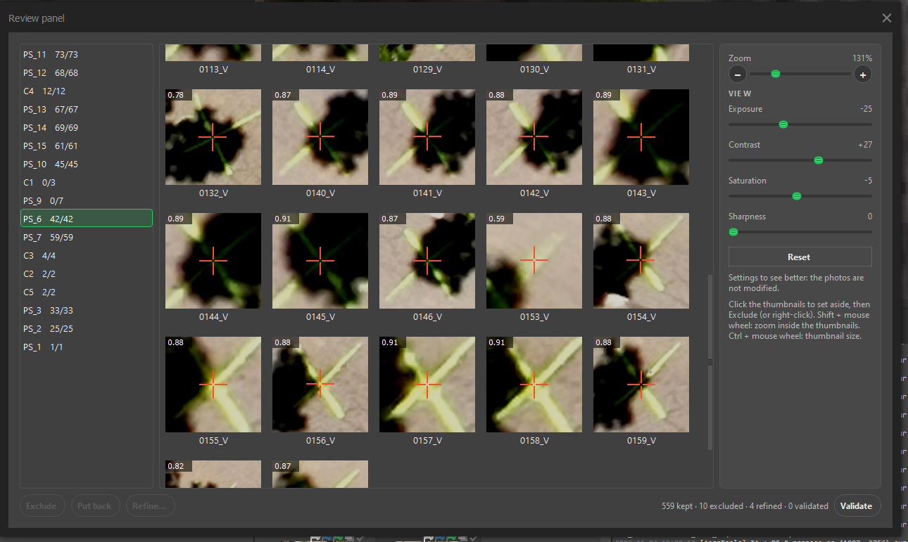

### The right-hand panel

- **Zoom** (the slider and the **+** and **−** buttons) zooms inside the thumbnails: more or less context around the point,
  from 50 % to 400 %. **Shift + mouse wheel** does the same. **Ctrl + mouse wheel** makes the thumbnails themselves bigger or
  smaller.
- **View** has four sliders: **Exposure**, **Contrast**, **Saturation** and **Sharpness**. They help your eye and nothing else.
  The photos, the crops and the points are never modified. The same values apply in the Refine window, and Aero-GCP remembers
  them. **Double-click** a slider (or its name or value) to put it back to 0, or use **Reset** for all four.

| Before | After |
|---|---|
| 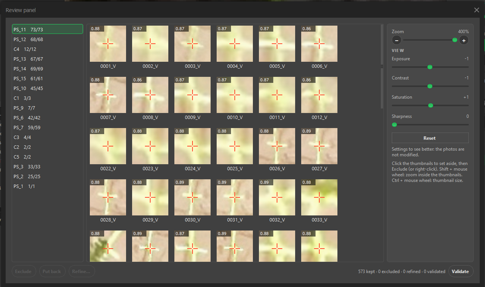 | 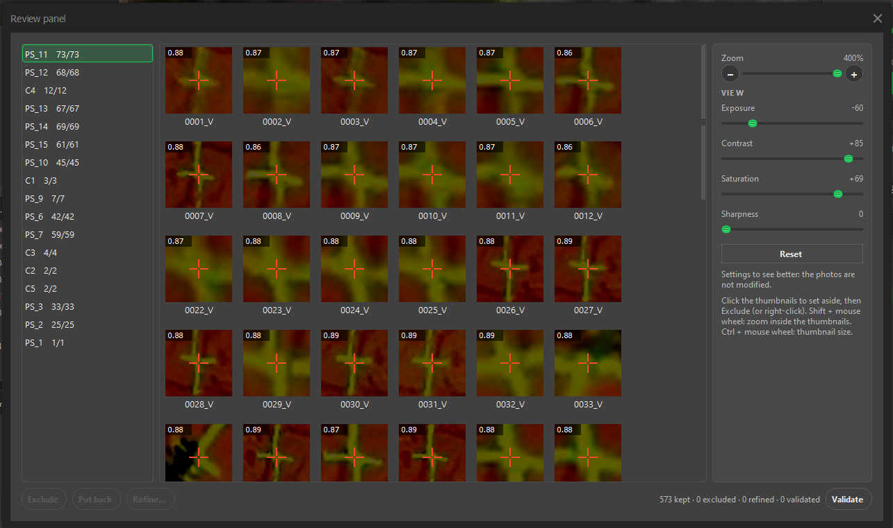 |

> **Note.** The View sliders need numpy, which Metashape ships. Without it they are disabled and the panel says so.

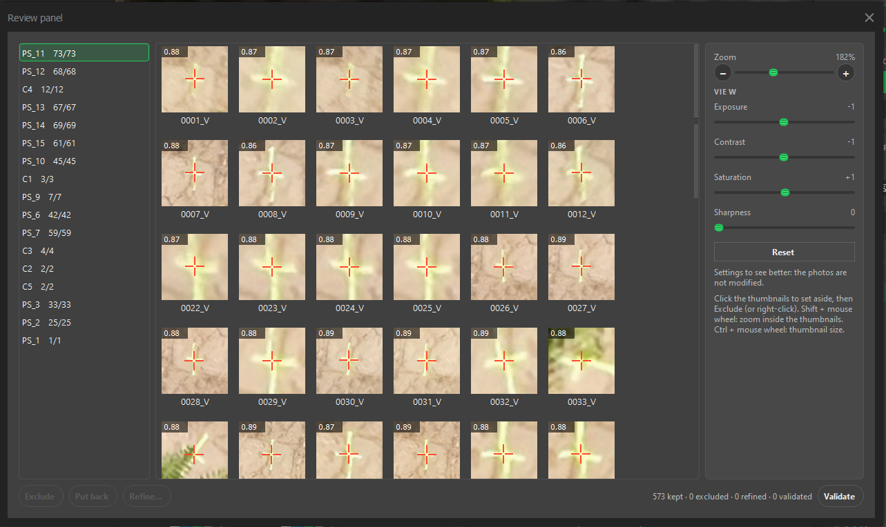

## 6. The Refine window

Select thumbnails and press **Refine…** (or Enter, or double-click one). One large window opens with all the selected photos, one at
a time. The title reads *Refine marker PS_11 on DJI_…* and the header shows the photo number.

- Click, or drag, on the true centre of the target. A green cross shows your pick; the red cross is the AI proposal.
- **Mouse wheel** zooms around the cursor. **Middle button** drag pans.
- The sliders of the Review panel are on the right and stay in sync with it.
- A bar at the bottom counts the picks (`3/15 picked`). **Next** (or Enter) goes to the next photo that has no pick yet.
- **Cancel** places nothing. **Validate and exit** places the picks you made. With all photos picked it turns green and reads
  **Validate**.

Points are placed only when you validate. Each one becomes a manual point, and Ctrl+Z undoes it. A thumbnail that is already
refined or validated can be refined again.

Back in the Review panel, a refined thumbnail shows your green cross and a green check at its top right, and the line at the bottom counts it as refined:

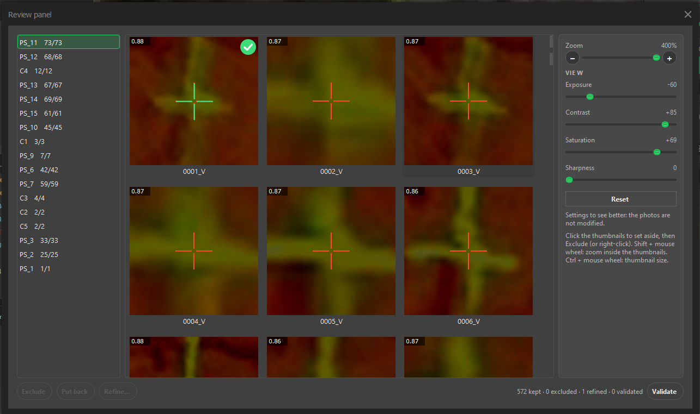

<!-- TODO screenshot: refine-window.png (the Refine window with the n/N progress bar and the green Validate button) -->

## 7. The PDF report

**Export > PDF report** writes a report of the current chunk: key figures, error charts, a table of the markers and screenshots.
If you ran an AI detection in this session, a section called *Photos picked by the AI* follows:

- one block per marker, with an error summary, the pointing gap in pixels, the AI confidence, and whether the marker is used
  as a GCP or only as a check point;
- one thumbnail per photo, with the red cross and the confidence below it (refined photos say *manual*);
- **excluded photos too**, darkened with a large red cross, counted in the marker's header and left out of its statistics.

Proposals that you cleared, and refinements you undid with Ctrl+Z, are left out. Every page footer links to
[helix.aero](https://helix.aero). **Export > CSV table** writes the marker table (ID, errors, projections, reference
coordinates).

<!-- TODO screenshot: report-ai-page.png (a page of the PDF with an excluded photo) -->

## 8. Settings and AI models

The **gear** in the header opens the Settings window.

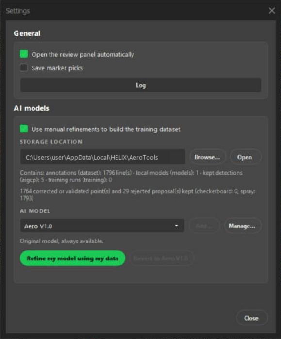

**General**

- *Open the review panel automatically* after a detection.
- *Save marker picks*: appends each manual click (photo path, position, marker) to a file in a visible folder, for future
  training. No image is copied.
- **Log**: the journal of the tool. If something breaks, paste its last lines in an issue.

**Updates**

**Check for updates...** (also in the **Aero** menu) opens the list of installed modules with their version and the date of the
last update. It looks at GitHub and says, for each one, how many files changed and how much there is to download. Click
**Update** on the line, or **Update all** at the bottom right. Do not close the window while it runs: every file is downloaded
and checked first, then replaced (if anything fails, the old files are put back), then the installed files are read again to
confirm. At the end AeroTools reloads by itself, no restart of Metashape. New entries of the Aero menu, if any, appear at the next
start. A development copy (a folder with `.git`) is never updated, so nothing gets overwritten.

**Detection engine**

- **Light**: ONNX Runtime on the processor, about 100 MB, any computer. **Precise**: the original engine (PyTorch, about 3 GB),
  graphics card used if there is one. **Automatic** uses Precise when it is installed, otherwise Light. On our test (569 targets)
  both put 99 % of the targets within 0.05 px of each other.
- The three lines below tell what is installed (*Light engine*, *Precise engine*, *Retraining tools*). When something is
  missing, **Install** does it for you: a black window shows the progress (do not close it), then the line turns to *installed*.
  The same happens if you start a detection or a retraining without what it needs: a box offers to install it.

**AI models**

- *Use manual refinements to build the training dataset*: when checked, every decision you take in the Review panel
  (exclude, refine, validate) is recorded in `aigcp_feedback.jsonl`. Uncheck it and nothing is recorded.
- **Storage location** and **Browse…**: the folder that holds this file and your own models. The default is
  `%LOCALAPPDATA%\HELIX\AeroTools`. A line under it counts what is recorded.
- **AI model**: **Aero V1.0** is ours and always there. The models you train are named **Local 1.1**, **Local 1.2**… and you
  cannot rename them. **Manage…** deletes the local ones; Aero V1.0 cannot be deleted. **Add…** is greyed out for now.
- **Refine my model using my data** retrains the detector on your annotations. **Revert to Aero V1.0** goes back to the
  original model at any time.

### What retraining does

Click **Refine my model using my data**. Aero-GCP first shows a warning that says:

- the model may get better on your targets and worse on others;
- what you marked as spray is learned as spray, and what you marked as checkerboard as checkerboard, so mistakes in your
  annotations make the result worse;
- the graphics card is used heavily for a while, so do not use the computer meanwhile;
- the original model is never modified.

Training starts again from the original weights each time, with all your recorded decisions, so mistakes of one attempt do not pile up.
For each target type it builds small crops around your corrected and validated points (positives), around the proposals you
rejected (negatives), and a few backgrounds. It keeps some targets aside to check the result. A type needs at least 30 positive
examples; below that it is skipped and the local model keeps the original weights for it. A progress bar follows the epochs and
**Cancel** stops it cleanly.

When it ends, the new **Local** model is selected, and you can test it on your next detection. If it scores clearly lower than
Aero V1.0 on the data kept aside, the window tells you. Use **Revert to Aero V1.0** if you prefer.

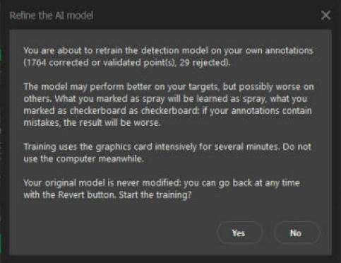

> **Note: what we measured.** One test on our own project, spray type only: 798 positive examples and 208 negative ones, 75
> seconds on an RTX 4070 graphics card. On the targets kept aside, mAP50 was 0.9762 for the new model and 0.9784 for
> Aero V1.0. That is no measurable difference, not an improvement. Retraining is an experiment: we do not promise that it
> makes detection better. Try the new model on a project you know, and press **Revert to Aero V1.0** if it does not do better.

### The full diagnostic

Under the marker list, the **Residual check** button lists the markers to watch. Its last line, **Full marking diagnostic...**, opens a
window that goes further. For each manual pick (green dot) it recomputes the marker's 3D position **without that photo**, projects it
back and tells how many pixels it falls from your pick. A few pixels is normal. It lists the doubtful picks (gap above 3 px, or
4 times the median of the project), the photos that are off on several markers, and the markers with too few picks or AI proposals
not yet validated. Double-click a line to open the photo, zoomed on the marker. A very shifted pick would make its neighbours look
wrong, so the worst pick is set aside and the others are judged again until nothing sticks out.

## 9. Troubleshooting

| Symptom | What to check |
|---|---|
| The **Aero** menu is missing | Double-click `CLICK HERE TO INSTALL.bat` again and restart Metashape. |
| *AI: AIGCP Python not found*, or a box titled *AI detection setup* | The detector runs in its own light Python (ONNX Runtime). The easiest fix is to double-click `CLICK HERE TO INSTALL.bat` again (it sets everything up, about 100 MB). By default Aero-GCP looks for `%USERPROFILE%\AIGCP\_env\Scripts\python.exe`; set the `AIGCP_PYTHON` environment variable, or the `python` key of the `aigcp` section in `settings.json`, to use another one. |
| *AI: … weights not found* | The two files `damier.pt` and `bombe.pt` should be in the `models` folder of the download: copy them back there if you deleted them, or set `models_dir` in the `aigcp` section. |
| The AI finds nothing | Check that the marker has a 3D position or reference coordinates, that the photos are aligned, and that the *Ignore* list is not hiding the photos you want. |
| A photo is not found or unreadable | The detector reads the original image files at the path Metashape knows. Make sure the drive or share is connected. |
| *Settings unavailable (numpy missing)* | The View sliders need numpy. Metashape normally ships it. |
| *Training failed* | Open the Settings window, then **Log**. The message says whether the Python environment, the script or the data is missing. |
| Something else breaks | Open the Log, copy the last lines and open an issue. |

Per-machine settings live in `%LOCALAPPDATA%\HELIX\AeroTools\settings.json`. Developer notes are in
[DEVELOPMENT.md](DEVELOPMENT.md).

AeroTools is made by [HELIX AERO](https://helix.aero). Source: [github.com/helix-aero/AeroTools](https://github.com/helix-aero/AeroTools).

## 10. Aero-Space: free disk space

**Aero > Aero-Space** opens a window that finds the old Metashape projects eating your disk. Pick a drive (or **Folder...**) and
click **Scan**: the heaviest projects come first. For each one you see the `.psx` file, the three folders above it (to recognise
the job), **Dense + depth maps** (what lightening frees, in GB), **Whole project** (to judge whether deleting it is worth it),
**Kept** (the files next to the project that deleting leaves alone, see below), the share of the first in the second, the date, and the state (*Open*, *Old lock* left by a crash, or an orphan `.files` folder
whose `.psx` is gone). Click a header to sort. Hover the size to see the detail (dense cloud, depth maps, tie points, DEMs,
orthos). Tick the projects, then:

- **Lighten (gentle)** removes the dense cloud and the depth maps, which can be recomputed. The alignment, markers, DEMs and
  orthos stay, and Metashape opens and saves each project so that it stays consistent.
- **Delete project** removes the `.psx` and its `.files` folder, and nothing else. The files exported next to the project (ortho,
  DEM, clouds, reports, in the same folder or one level down) are not touched: the **Kept** column counts them, hover it for the
  biggest ones. A warning sign there means the project holds a DEM or an ortho built in Metashape and no exported file (tif,
  ecw, las, dxf...) was found next to it: those are inside the `.files` and would go with the project, so export them first if
  you need them.

**Delete project** asks where it goes: **Recycle Bin** (you can restore it; the space is freed when you empty the bin; not available
on a network drive) or **Delete permanently**, which asks you to type `DELETE`. **Lighten** is always final and always asks you to
type `DELETE`: Metashape erases those files itself when it saves the project, so there is no Recycle Bin for it. A project that is open in a Metashape (even on another
computer) is never touched. Every action is written to a log (the **Action log** button).

**Test it on a copy first.** Copy a small project (the `.psx` and its `.files` folder) to a test folder, scan that folder, and
try both modes on the copy before using it on real work.
