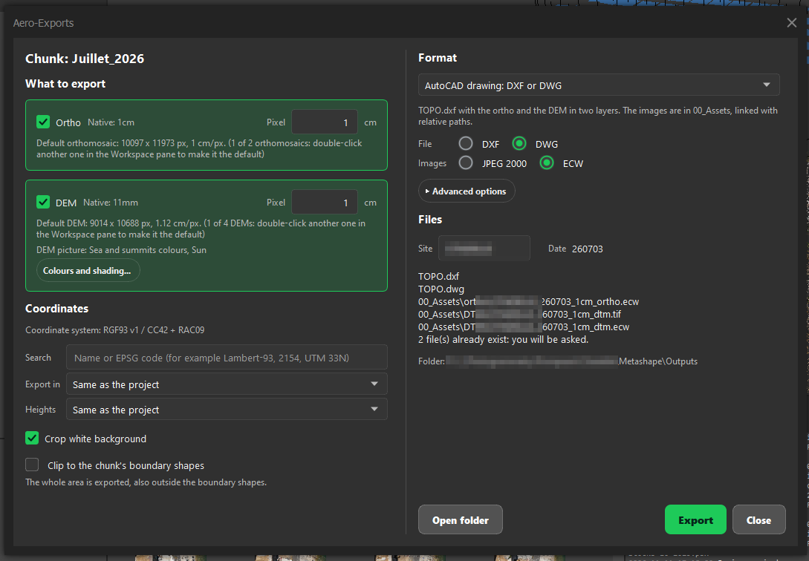
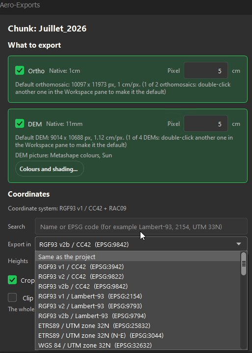
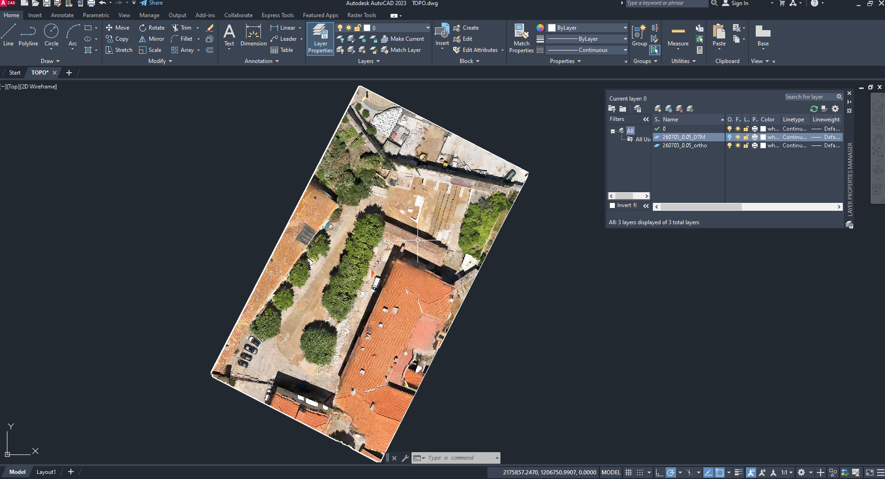
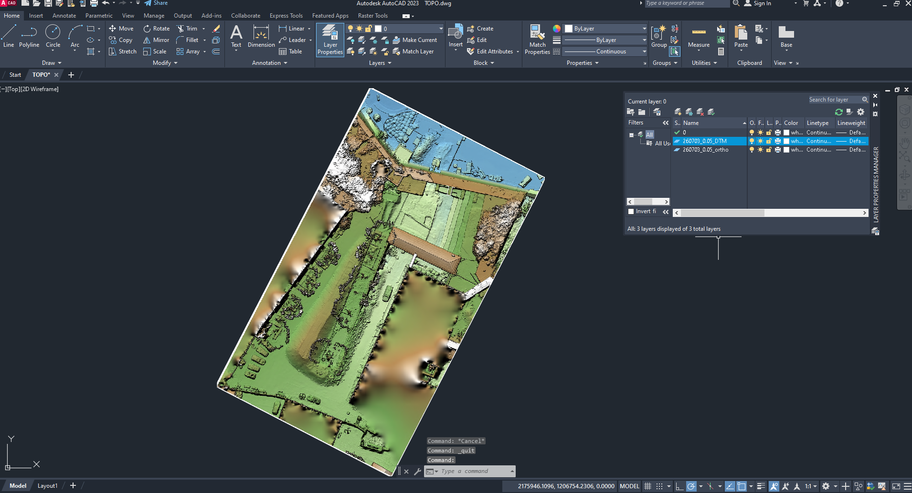
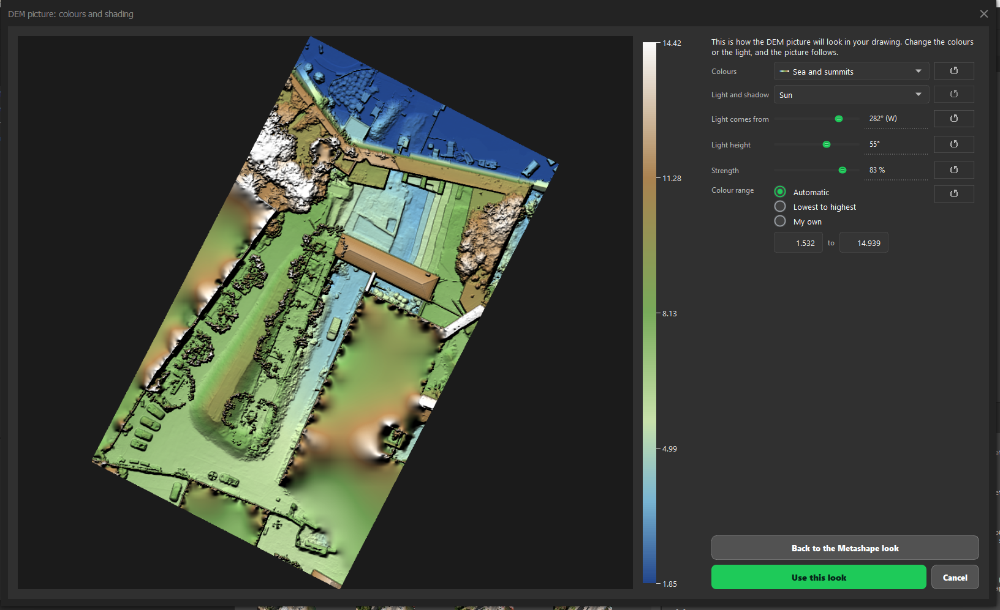
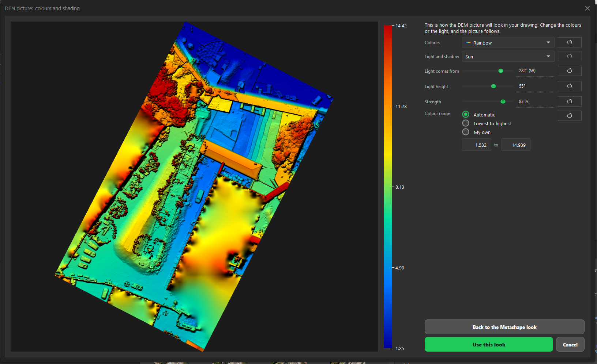

# Aero-Exports: export the ortho and the DEM

**Aero > Aero-Exports** writes the orthomosaic and/or the DEM of the open project to an `Outputs` folder next to the `.psx`
(save the project first). The window follows the active chunk by itself, and its first line names the chunk.

- [1. Choose what to export](#1-choose-what-to-export)
- [2. Choose the format](#2-choose-the-format)
- [3. Coordinates and heights](#3-coordinates-and-heights)
- [4. Export](#4-export)
- [The AutoCAD drawing](#the-autocad-drawing)
- [DEM colours and shading](#dem-colours-and-shading)

## 1. Choose what to export

Tick **Ortho** and/or **DEM**. Each card shows the raster's native pixel and which raster it is (size and pixel). If you want
another pixel size, type it in cm: the size you type is exact, and the ortho and the DEM then share the same grid. A card warns
when the default DEM is much coarser than the ortho.

A chunk can hold several DEMs and orthomosaics. Aero-Exports always exports the **default** one, the one in normal font in the
Workspace pane. Double-click another to make it the default.

Metashape cuts an export to the chunk's boundary shapes. When the chunk has some, a box **Clip to the chunk's boundary shapes**
appears. It is off by default: the whole area of the DEM is exported, as you see it in Metashape. Tick it to cut the export to the shapes.

## 2. Choose the format

| Format | What you get |
|---|---|
| **GeoTIFF, full quality** | The raster as it is. |
| **Client quick view** | A GeoTIFF with JPEG compression, about 10 times smaller. The DEM stays lossless. |
| **JPEG + world file** | A JPEG and its positioning file. The DEM heights stay a GeoTIFF; the coloured DEM picture, if you ask for it, is a JPEG with its own world file (`..._dtm.jpg` and `..._dtm.jgw`). |
| **JPEG 2000** | Written with QGIS or Global Mapper. |
| **ECW** | Written by Global Mapper, which must be installed. |
| **AutoCAD drawing** | A DXF or DWG with the ortho and the DEM. DWG needs AutoCAD, which converts the DXF in the background. |

**Split into tiles** (under **Advanced options**) cuts the export into square tiles of a chosen size, one file each. Empty tiles
are skipped.

Files get short names: site, date, pixel and type, for example `SITE_260704_3cm_ortho.tif` and `SITE_260704_3cm_dtm.tif`. You can
change the **Site** name and the list under **Files** shows what will be written. If a file already exists, you choose between
overwriting it and a new version (`_v2`).

## 3. Coordinates and heights

**Export in** converts to another coordinate system: search by name or EPSG code, or pick one from the list. **Heights** does the
same for the height system. AeroTools computes the heights itself from the geoid grid, which it downloads once on request from
the official PROJ grid server. A raster in degrees is switched to a metric system, because a pixel in cm needs metres.

## 4. Export

Click **Export**. A progress bar shows each file as it is written. **Open folder** opens the `Outputs` folder.

## The AutoCAD drawing

`TOPO.dxf` (or `TOPO.dwg`) holds the ortho and the DEM in two layers. The image files sit in `00_Assets` and are linked with
relative paths, so the folder can be moved or sent as it is. **Crop white background**, on by default, makes AutoCAD show only
the real data area of each image. The image files themselves are not changed.

The two layers are named after the date and the pixel size. Turn one off to see the other.

## DEM colours and shading

**Colours and shading...** opens a window with a live preview of the DEM picture. You choose the palette, the light (sun, four
lights or slope), its direction and height, its strength and the colour range. The drawing uses the look you keep, and the
setting is saved on this computer. Next to any export you can also save that coloured picture: as JPEG 2000 or ECW with those formats, as a JPEG with its world file with
the JPEG preset, and as a coloured GeoTIFF (`..._dtm_view.tif`, so it never takes the name of the heights) with the GeoTIFF presets.

**Back to the Metashape look** restores the default colours.

## Checked and not checked

The DWG drawing opens in AutoCAD 2023 with both images. Not checked by hand yet: the clip, and the speed of very large
images in the AutoCAD window itself. They were tested with AutoCAD's console engine only.
