# Aero-GCP

Aero-GCP marks ground control points (GCPs) in Agisoft Metashape. You can click the targets yourself, or let an AI propose the
marks and review them. It also checks the marking, helps you choose which markers act as control points, and writes a report.

This page follows the order you will use it in. Button and list names are written as they appear in the interface.

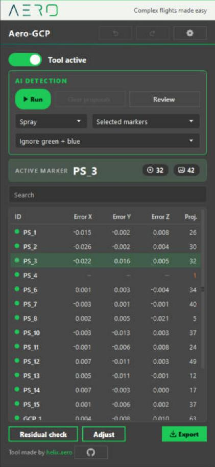

- [1. Open the tool](#1-open-the-tool)
- [2. The panel](#2-the-panel)
- [3. Mark by hand](#3-mark-by-hand)
- [4. The marker table](#4-the-marker-table)
- [5. AI detection](#5-ai-detection)
- [6. Review the proposals](#6-review-the-proposals)
- [7. Check your marking](#7-check-your-marking)
- [8. Adjust: choose the control markers](#8-adjust-choose-the-control-markers)
- [9. Export](#9-export)
- [10. Settings](#10-settings)
- [Tips](#tips)
- [Troubleshooting](#troubleshooting)

## 1. Open the tool

Install Aero-GCP first (see the [install section of the README](../../README.md#install)). Then:

1. Open the **Aero** menu of Metashape and click **Aero-GCP**, or press **F8**.
2. The panel docks on the right of the window. If you close it, open it again the same way.

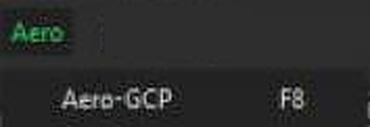

You need a chunk with aligned photos and markers. A marker can have reference coordinates only: it does not need a placed
point to be found by the AI.

## 2. The panel

From top to bottom:

| Area | What it is for |
|---|---|
| Header | The title, **Undo** and **Redo** (Ctrl+Z, Ctrl+Y), and the **gear** that opens the settings (section 10). |
| **Tool active** switch | Turns the tool on or off. When it reads **Tool inactive**, Metashape behaves as usual. |
| **AI DETECTION** card | **Run**, **Clear proposals**, **Review**, and three lists: target type, scope, photos to ignore (section 5). |
| **Active marker** | The marker you are working on: its name, the photos where it is placed, the photos that see it. |
| Marker table | Every marker of the chunk, with its errors and number of projections. A **Search** box filters it (section 4). |
| **Residual check** | A window that lists the markers to watch (section 7). |
| **Adjust** | A window that helps you choose the control markers (section 8). |
| **Export** | Writes a PDF report or a CSV table (section 9). |

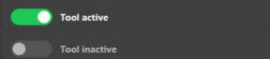

## 3. Mark by hand

1. Pick a marker in the panel, or in the Reference pane of Metashape. Both stay in sync.
2. The Photos pane filters itself to the photos that see this marker, and the photo view opens on one of them, zoomed on the
   area around the marker.
3. Click on the center of the target. The point is placed exactly where you clicked.
4. The next photo that sees the marker and has no point yet opens by itself, zoomed on the marker. Click again.
5. When the marker is done, pick the next one.

**Ctrl+Z** (or the Undo button) takes back the last point. Aero-GCP keeps the last 100. **Ctrl+Y** (or **Ctrl+Shift+Z**) puts it
back. **Shift+click** and **Ctrl+Shift+M** (point under the cursor) place a point too.

If the photo view is already zoomed, Aero-GCP keeps your zoom and only re-centers on the marker. On a photo that is still fitted
to the window, it shows about 400 pixels around the marker.

## 4. The marker table

The table lists every marker of the chunk:

| Column | Meaning |
|---|---|
| **ID** | The marker name. |
| **Error X**, **Error Y**, **Error Z** | Estimated position minus reference, in meters. |
| **Proj.** | Number of photos where the marker is placed. |

Click a column header to sort: ascending, descending, then back to the project order. Type in **Search** to filter by name.

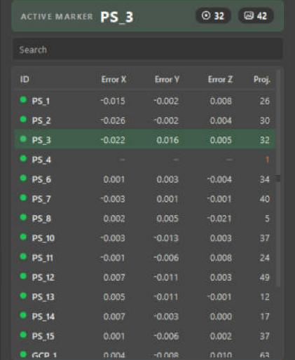

**Select several markers.** **Shift+click** selects a range, **Ctrl+click** adds or removes one. The last marker you clicked stays
the active one. This selection is what **Selected markers** means in the AI detection card.

**Remove projections or markers.** Right-click the selection:

| Menu entry | What it does |
|---|---|
| **Remove projections (n)** | Removes every projection of the selected markers: placed by hand, computed by Metashape, or proposed by the AI. The markers stay in the project. |
| **Remove markers (n)** | Deletes the selected markers from the project. |

Both ask for confirmation. Aero-GCP cannot bring deleted markers back, so save your project first.

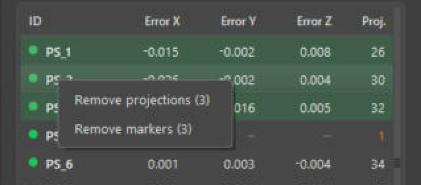

## 5. AI detection

The AI proposes a point on every photo that should see a marker. A proposal is not a placed point: you review it first.

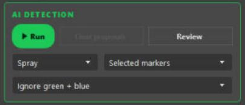

1. **Choose the target type.** The type must match the targets in your photos.
2. **Choose the scope.**
3. **Choose which photos the AI leaves alone.**
4. Press **Run**.
5. Wait. A bar shows the photos done and **Cancel** stops the job. Metashape stays usable meanwhile.
6. When it ends, the Review panel opens (section 6). The **Review** button opens it again.

**Target type**

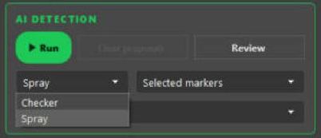

| Choice | Use it for |
|---|---|
| **Checker** | A printed 2x2 checkerboard target. |
| **Spray** | A mark made with paint or chalk. |

Each type has its own model, and they are never mixed. Pick the one that matches your targets. With the wrong type the AI
finds little, or marks something else that looks like a target. If a project has both kinds, run the detection twice.

**Scope**

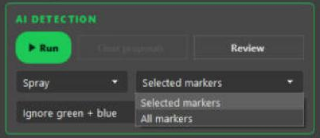

| Choice | The AI works on |
|---|---|
| **Selected markers** | The active marker, or every marker you selected in the table with Shift or Ctrl. |
| **All markers** | Every marker that has a 3D position. |

**Photos to leave alone**

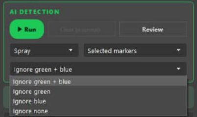

| Choice | The AI skips |
|---|---|
| **Ignore green + blue** | Photos with a point you placed (green) or a point computed by Metashape (blue). This is the default. |
| **Ignore green** | Only photos with a point you placed. |
| **Ignore blue** | Only photos with a point computed by Metashape. |
| **Ignore none** | Nothing: the AI goes over every photo. |

Your three choices are remembered on this computer.

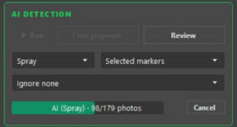

**What you get**

- A proposal is a blue point that is not pinned. It never replaces a point you placed and does not count as a placed photo.
  Clicking the target replaces it with a normal point.
- Two checks reject doubtful detections. The status line counts them as *rejected by the guard*. The first rejects a detection
  too far from where the other projections of the marker say it should be (a roof, a tree). The second requires the
  detections of one target to meet at a single 3D point.
- **Clear proposals** removes every proposal not validated yet and puts back the point that was there before. It never touches
  the blue points of Metashape.

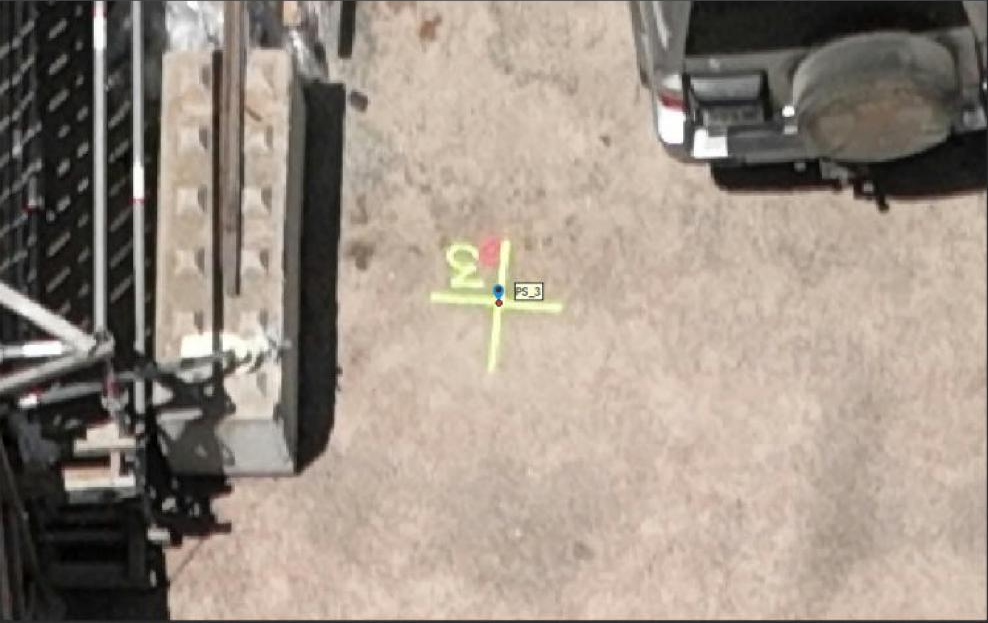

> **Note.** An unvalidated proposal moves the estimated position of the marker in Metashape. Validate or clear the proposals
> before you trust the errors in the table.

## 6. Review the proposals

The Review panel shows one thumbnail per photo: a crop around the proposed point, a red cross on it, the AI confidence in the
corner, and the photo name below. Markers are on the left. The most doubtful markers come first, and inside a marker the least
sure photos come first, so you check the risky ones before the obvious ones.

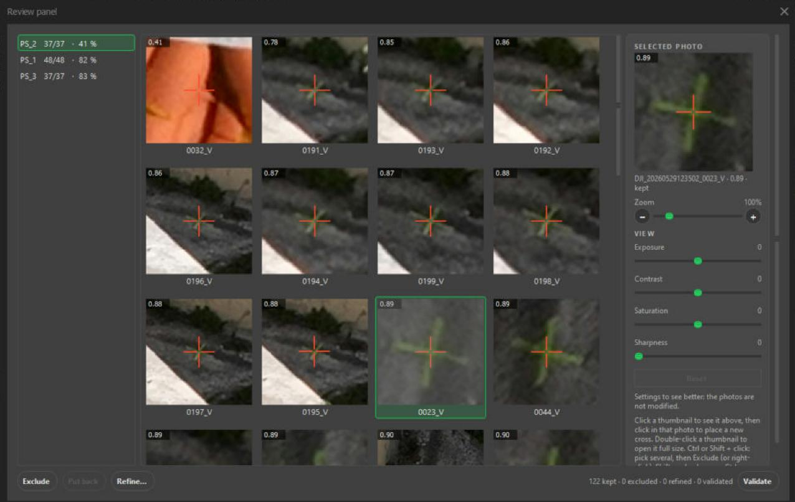

1. Click the bad thumbnails. A click selects, another click unselects. No Ctrl needed.
2. Press **Exclude** for the proposals that are wrong, or **Refine…** to place the point yourself.
3. When you are happy with the rest, press **Validate**.

| Button | Shortcut | What it does |
|---|---|---|
| **Exclude** | Delete, or right-click | Takes the proposal out of the project now; the previous point comes back. It also works on validated and refined points: the app asks first, then undoes that manual point. |
| **Put back** | Right-click | Undoes an exclusion. |
| **Refine…** | Enter, double-click, or right-click | Opens the selected thumbnails in the Refine window, one photo at a time. |
| **Validate** | | Turns every kept proposal into a manual point, after a confirmation. |

The buttons are grey when they have nothing to act on.

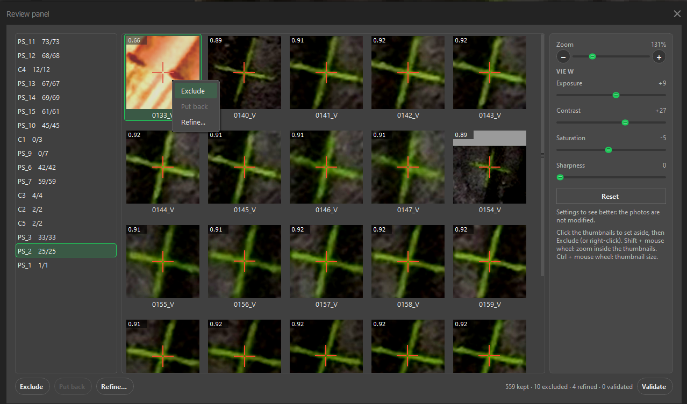

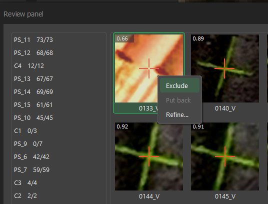

**Status tags.** A small tag in the top-right corner of each thumbnail shows its state, and the tooltip says it in words.

| Tag | State |
|---|---|
| none | Kept: a proposal, not validated yet. |
| Red cross, thumbnail dimmed | **Excluded**. |
| Green check | **Refined**: placed by hand. |
| Hollow check | **Validated** as it was proposed. |

The line at the bottom counts them: `17 kept · 1 excluded · 23 refined · 0 validated`.

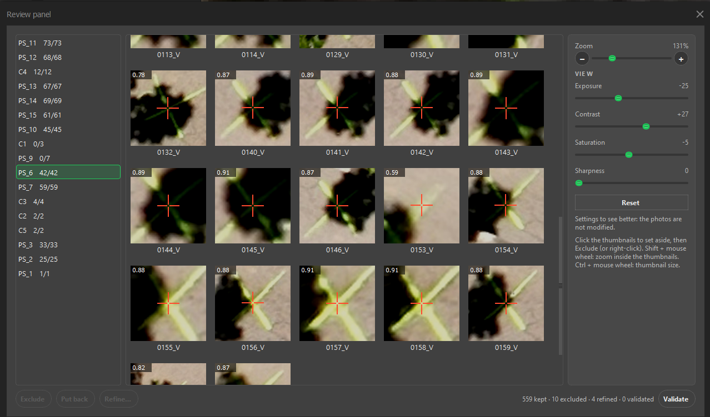

**The right-hand panel**

- **SELECTED PHOTO** shows the last thumbnail you clicked, larger. A click in it places a new cross at that spot.
- **Zoom** (the slider and the **+** and **−** buttons) shows more or less context around the point, from 50 % to 400 %.
  **Shift + mouse wheel** does the same. **Ctrl + mouse wheel** makes the thumbnails themselves bigger or smaller.
- **VIEW** has four sliders: **Exposure**, **Contrast**, **Saturation** and **Sharpness**. They help your eye and change nothing
  else: the photos, the crops and the points are never modified. **Reset** puts all four back to 0, and a double-click on one
  slider does it for that slider. The sliders need numpy, which Metashape ships.

| Before | After |
|---|---|
| 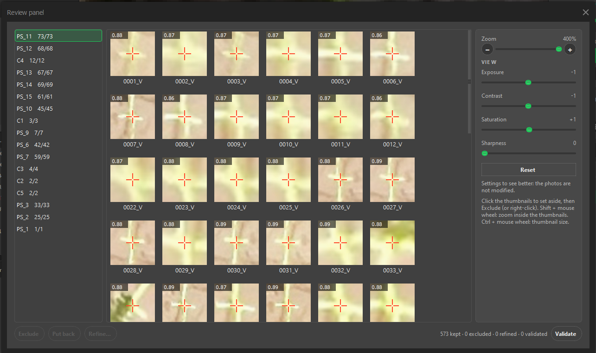 | 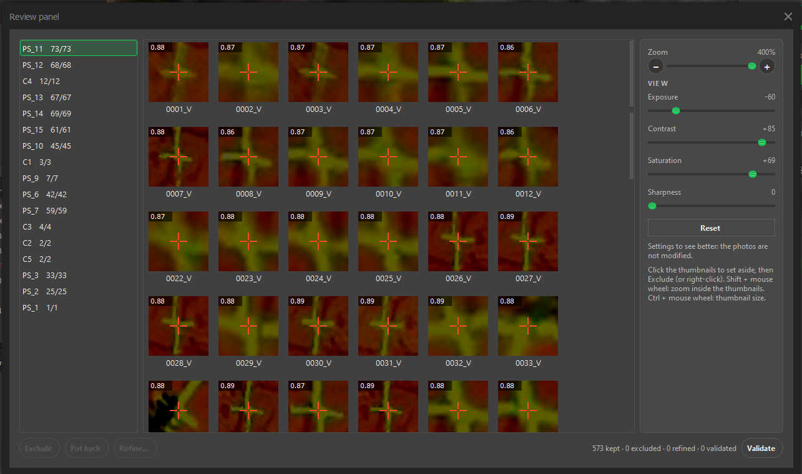 |

**The Refine window.** Select thumbnails and press **Refine…** (or Enter, or double-click one).

1. Click, or drag, on the true center of the target. A green cross shows your pick; the red cross is the AI proposal.
2. **Mouse wheel** zooms around the cursor. The **middle button** drags the photo.
3. Press **Next** (or Enter) to go to the next photo without a pick.
4. A bar at the bottom counts the picks (`3/15 picked`). Press **Validate and exit** to place the picks you made. With all the
   photos picked, the button turns green and reads **Validate**. **Cancel** places nothing.

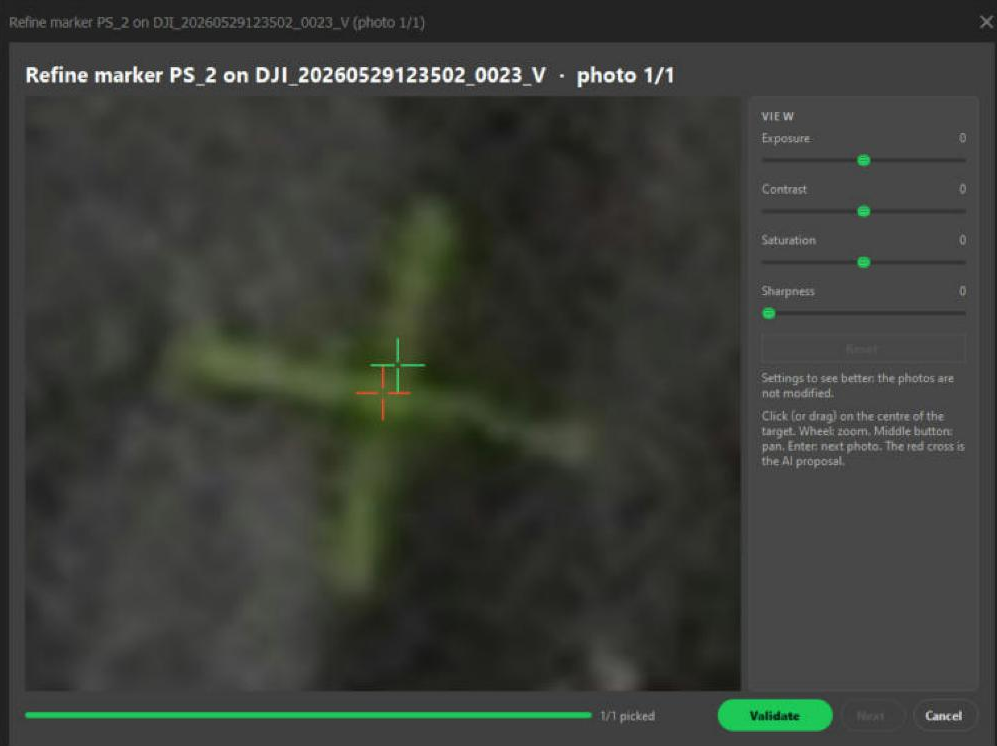

Points are placed only when you validate. Each one becomes a manual point, and Ctrl+Z undoes it. A thumbnail that is already
refined or validated can be refined again.

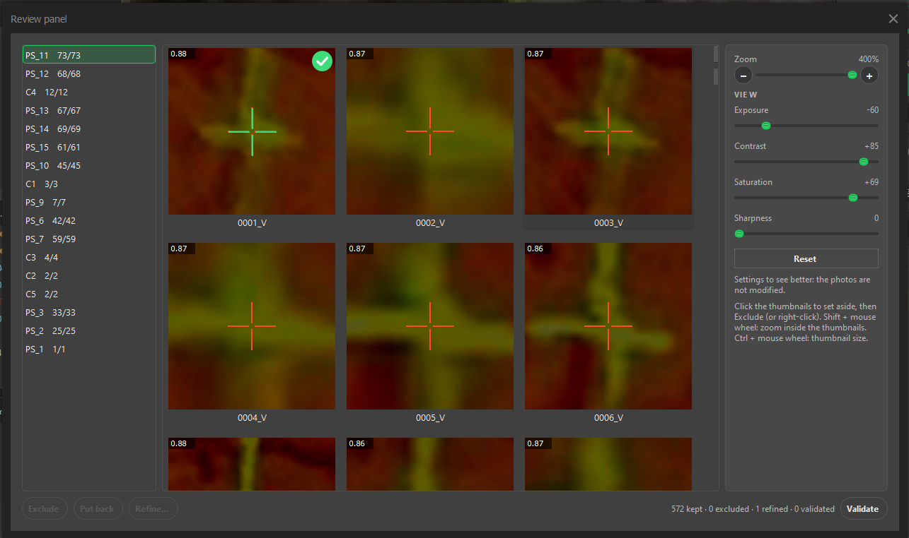

**Validate** shows a small waiting window while the points are placed. When it ends, and after every exclusion or refinement, the
marker table is read again.

## 7. Check your marking

**Residual check** opens the Marker check window. Three tiles at the top give the RMS error of the **Control** markers (ticked
in Reference), of the **Check** markers (not ticked), and the number of markers **To watch**. The table lists every marker,
the most urgent first:

| Column | Meaning |
|---|---|
| **Marker**, **Photos** | The marker, and the photos where it is placed. |
| **X (cm)**, **Y (cm)**, **Z (cm)**, **3D (cm)** | The errors, in centimeters. |
| **Role** | **Control** or **Check**. |
| **Status** | **OK**; **High residual** (above the larger of 3 cm and three times the low median of the chunk); **Few photos** (fewer than 3); **Not computed**. |

Double-click a line, or select it and press **Open**: the marker becomes active and, for a high residual, its worst photo opens.
**Refresh** reads the markers again.

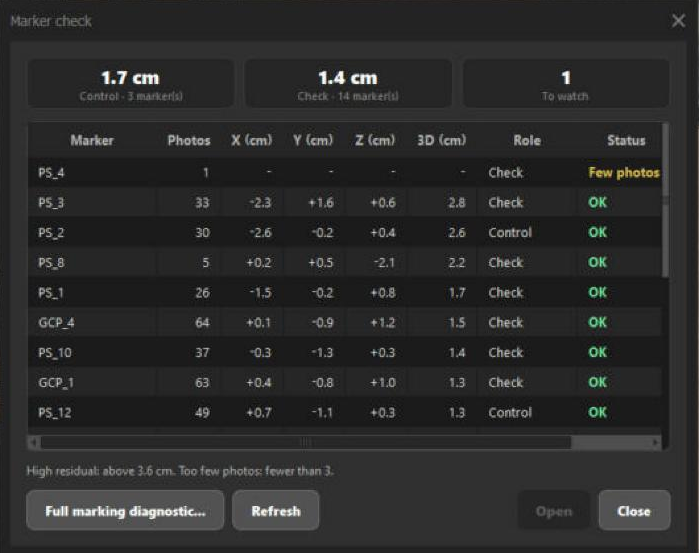

**Full marking diagnostic...** goes further. For each manual pick (green point), it recomputes the 3D position of the marker without
that photo, projects it back and tells how many pixels it falls from your pick. A few pixels is normal. It lists the doubtful
picks (above 3 px, or four times the median of the project), the photos that are off on several markers, and the markers with
too few picks or AI proposals not validated yet. Double-click a line, or select it and press **Open the photo**, to see the photo zoomed on the marker. **Recompute** runs
it again.

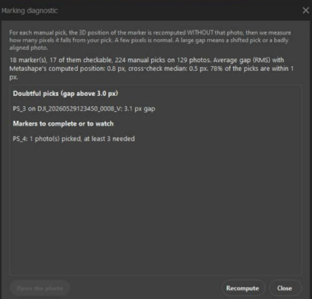

## 8. Adjust: choose the control markers

In Metashape, a marker is either a control point (ticked in Reference: it drives the georeferencing) or a check point (not
ticked: it only measures). **Adjust** helps you choose which markers to tick, before **Optimize Cameras**. It does not run any
Metashape computation: it fits the transformation on a set of markers and measures the error on the others, for many sets.

1. Press **Adjust**. The Control markers window opens and reads the markers of the chunk.
2. Pick the model in the list at the top (see below). The window preselects **Shift only** when at least half of the cameras have
   a position that is used, and **Full frame** otherwise.
3. Read the **Now** table: the errors Metashape shows today for the markers ticked (**GCP**) and not ticked (**CTRL**), in cm.
4. Read the **Options** table: one row per number of control markers, with the best set found, and the errors measured on the
   markers left aside. The recommended row has a check mark and is preselected.
5. Select another row if you prefer. Press **Tick these markers**, then confirm.
6. Save your project, run **Optimize Cameras** in Metashape, and check the results in Reference.

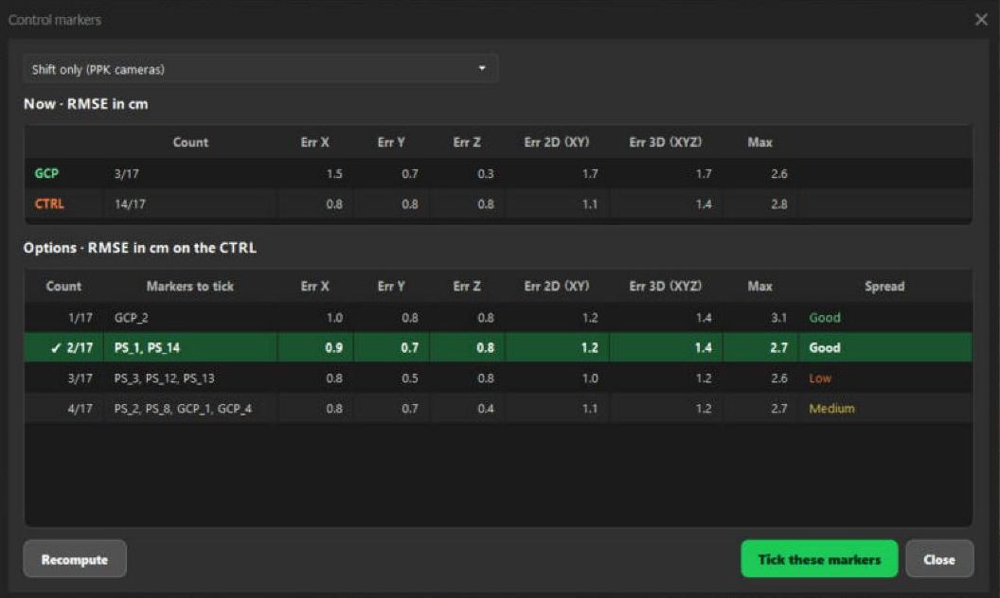

**Model**

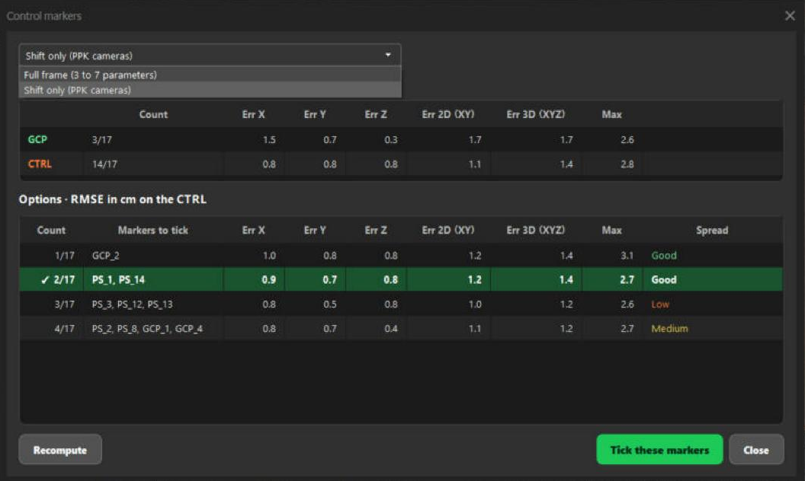

| Choice | Use it when |
|---|---|
| **Full frame (3 to 7 parameters)** | The markers alone georeference the project. At least 3 markers that are not on one line are needed. |
| **Shift only (PPK cameras)** | The cameras already have a good position (PPK or RTK) and the markers only correct a constant offset. A single marker is enough. |

**Columns of the Options table**

| Column | Meaning |
|---|---|
| **Count** | Number of control markers in the set, out of the markers usable. |
| **Markers to tick** | The best set of that size. |
| **Err X**, **Err Y**, **Err Z**, **Err 2D (XY)**, **Err 3D (XYZ)**, **Max** | The errors in cm, measured on the markers not in the set. |
| **Spread** | How well the set covers the area: **Good**, **Medium** or **Low**. |

Under the tables, the window warns about markers to check first (a suspect pick or suspect coordinates) and about markers left out
because they have fewer than 3 photos. **Recompute** reads the markers again, for example after you fixed a pick.

> **Note.** **Tick these markers** ticks the chosen set and unticks all the others. It changes your project: save it first if you
> want to be able to go back. **Optimize Cameras** also corrects soft deformations (focal length, distortion), so the real
> error after it can be better than the one shown here. Adjust tells you which markers carry the information and which are
> suspect, not the final figure.

## 9. Export

**Export** opens a menu with two entries. Each one asks where to save the file.

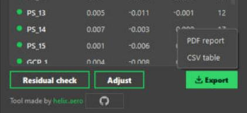

| Entry | What it writes |
|---|---|
| **PDF report** | A report of the current chunk: key figures, error charts, a table of the markers and screenshots. After an AI detection in this session, it adds the section *Photos picked by the AI*. |
| **CSV table** | The marker table: ID, errors X, Y, Z and total, projections, reference coordinates. |

The AI section has one block per marker with an error summary, the pointing gap in pixels, the AI confidence, and whether the
marker is used as a GCP or only as a check point. It shows one thumbnail per photo, and the excluded photos too, darkened with a
large red cross and left out of the statistics. Proposals you cleared and refinements you undid are left out. Every page footer
links to [helix.aero](https://helix.aero).

See [an example report](../example_gcp_report.pdf).

## 10. Settings

The **gear** in the header opens the Settings window. It has five blocks.

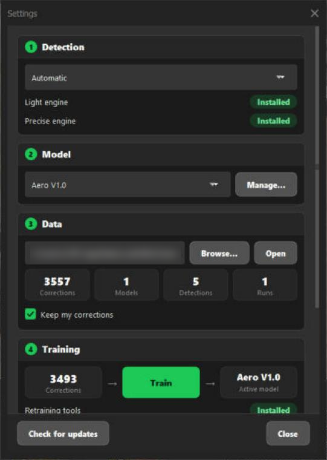

**1. Detection**

- The list picks the engine: **Automatic**, **Light** (about 100 MB, any computer) or **Precise** (about 3 GB, uses the graphics card
  if there is one). **Automatic** uses Precise when it is installed, otherwise Light. On our test, with several hundred targets, both
  put 99 % of the targets within 0.05 px of each other.
- Under it, the two engines show **Installed** or an **Install** button. **Install** opens a black window that shows the progress
  (do not close it). The same offer appears if you start a detection without the engine it needs.

**2. Model**

- The list shows the model in use. **Aero V1.0** is the model we ship. The models you train are named **Local 1.1**, **Local 1.2**…
  with their date, and cannot be renamed.
- **Manage…** deletes local models. Aero V1.0 cannot be deleted.

**3. Data**

- The line shows the storage folder (default `%LOCALAPPDATA%\HELIX\AeroTools`). It holds your decisions and your own models.
  **Browse…** changes it, and offers to copy what is in the current folder. **Open** opens it in Explorer.
- Four tiles count what is stored: **Corrections**, **Models**, **Detections**, **Runs**.
- **Keep my corrections**: when checked, every decision you take in the Review panel (exclude, refine, validate) is recorded
  in `aigcp_feedback.jsonl`, in the storage folder. Uncheck it and nothing is recorded. No image is copied.

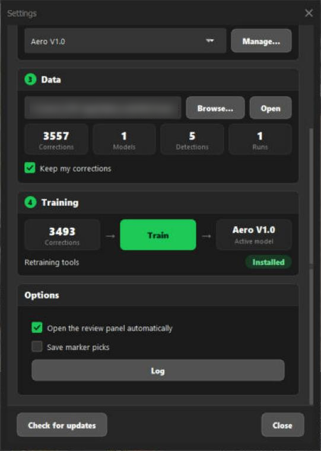

**4. Training**

- The flow reads **Corrections**, then **Train**, then **Active model**. **Train** retrains the detector on your corrections. It is
  grey until you have at least one correction, and a target type needs at least 30 corrected or validated points to be trained.
- **Retraining tools** shows **Installed** or an **Install** button (about 3 GB).
- **Revert to Aero V1.0** appears when a local model is active, and brings the original model back. The original is never modified.

**Options**

- **Open the review panel automatically** after a detection (on by default).
- **Save marker picks**: appends each manual click (photo path, position, marker) to a file in the storage folder, for future
  training. No image is copied.
- **Log** shows the journal of the tool. If something breaks, paste its last lines in an issue.

At the bottom, **Check for updates** opens the list of installed tools, with their version, and updates them from GitHub.

### What Train does

**Train** first shows a warning that says:

- the model may get better on your targets and worse on others;
- what you marked as spray is learned as spray, and what you marked as checkerboard as checkerboard, so mistakes in your
  annotations make the result worse;
- the graphics card is used heavily for several minutes, so do not use the computer meanwhile;
- the original model is never modified.

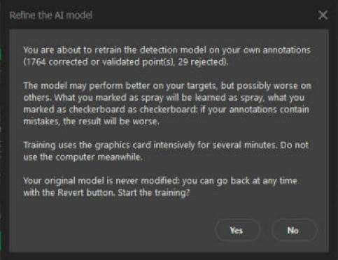

Training starts again from the original weights each time, with all your recorded decisions. For each target type it builds small
crops around your corrected and validated points (positives), around the proposals you rejected (negatives), and a few
backgrounds. It keeps some targets aside to check the result. A progress bar follows the epochs, and **Cancel** stops it cleanly.
When it ends, the new **Local** model is selected, and the window tells you if it scores clearly lower than Aero V1.0 on the data
kept aside.

> **What we measured.** One test on our own project, spray type only: several hundred positive and negative examples, about a
> minute on a recent graphics card. On the targets kept aside, mAP50 was 0.9762 for the new model and 0.9784 for Aero V1.0. That is
> no measurable difference, not an improvement. Training is an experiment: we do not promise that it improves detection on your
> data. Try the new model on a project you know, and press **Revert to Aero V1.0** if it does not do better.

## Tips

- Run the AI on a few markers first with **Selected markers**, look at the result, then run **All markers**.
- Keep **Ignore green + blue** while you work: the AI then fills only the photos you have not marked.
- Review the markers at the top of the list first: they are the least sure.
- Use the **View** sliders in the Review panel on dark or washed-out photos. They change nothing in your project.
- After validating, open **Residual check**, then **Adjust**, then run **Optimize Cameras**.
- Pause the tool with the switch when you want Metashape's own behavior back.

## Troubleshooting

| Symptom | What to check |
|---|---|
| The **Aero** menu is missing | Double-click `CLICK HERE TO INSTALL.bat` again and restart Metashape. |
| **Aero-GCP** is missing from the **Aero** menu | It is not installed: **Aero > Install plugins...**, then **Install** on it. |
| *AI: AIGCP Python not found*, or a box titled *AI detection setup* | The detector runs in its own light Python (ONNX Runtime). The easiest fix is to double-click `CLICK HERE TO INSTALL.bat` again (about 100 MB), or press **Install** in the Settings window. By default Aero-GCP looks for `%USERPROFILE%\AIGCP\_env\Scripts\python.exe`; set the `AIGCP_PYTHON` environment variable, or the `python` key of the `aigcp` section in `settings.json`, to use another one. |
| *AI: … weights not found* | The files `checker.pt` and `spray.pt` should be in the `models` folder of the download. Copy them back if you deleted them, or set `models_dir` in the `aigcp` section. |
| The AI finds nothing, or marks the wrong thing | Check the **target type**: Checker and Spray are different models. Check that the marker has a 3D position or reference coordinates, that the photos are aligned, and that the *Ignore* list is not hiding the photos you want. |
| A photo is not found or unreadable | The detector reads the original image files at the path Metashape knows. Make sure the drive or share is connected. |
| *Settings unavailable (numpy missing)* | The View sliders need numpy. Metashape normally ships it. |
| **Train** is grey | It needs at least one correction. Refine or validate some targets in the Review panel, with **Keep my corrections** checked. |
| *Training failed* | Open the Settings window, then **Log**. The message says whether the Python environment, the script or the data is missing. |
| **Adjust** says it cannot compute | It needs enough markers pinned on at least 3 photos each (3 or more markers with **Full frame**, 1 or more with **Shift only**, plus one to measure on). |
| Something else breaks | Open the Log, copy the last lines and open an issue. |

Per-machine settings live in `%LOCALAPPDATA%\HELIX\AeroTools\settings.json`. Developer notes are in
[DEVELOPMENT.md](../DEVELOPMENT.md).

AeroTools is made by [HELIX AERO](https://helix.aero). Source: [github.com/helix-aero/AeroTools](https://github.com/helix-aero/AeroTools).
