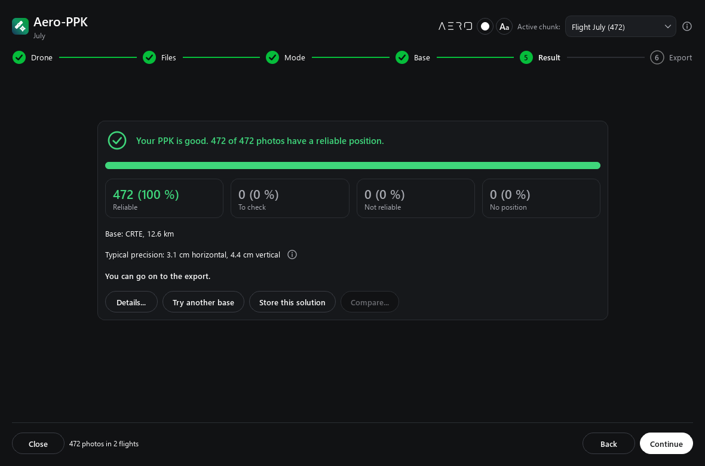
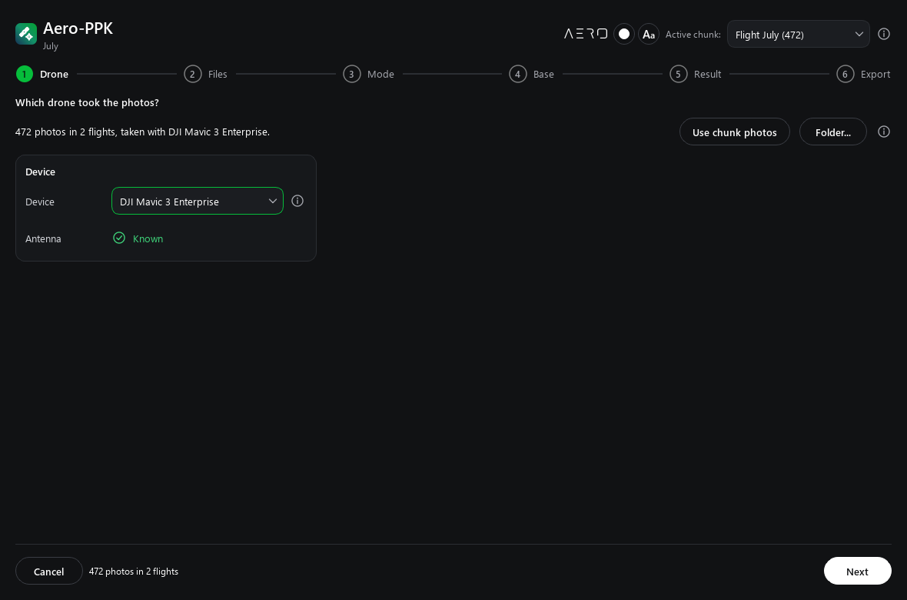
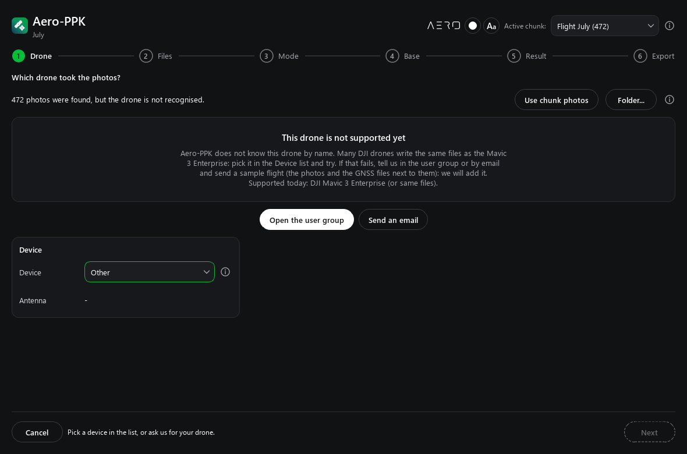
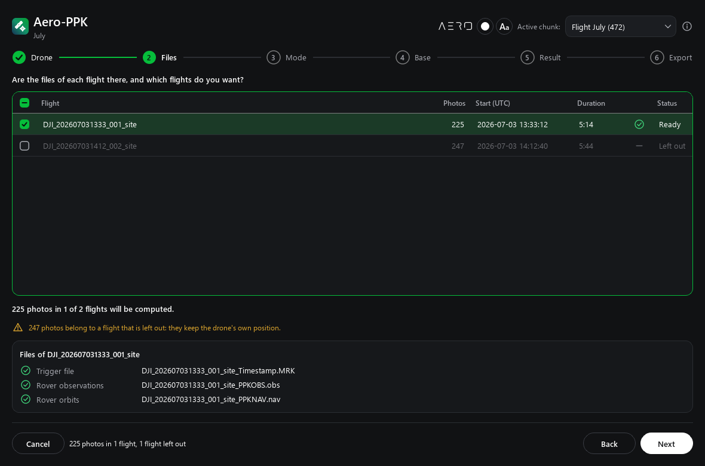
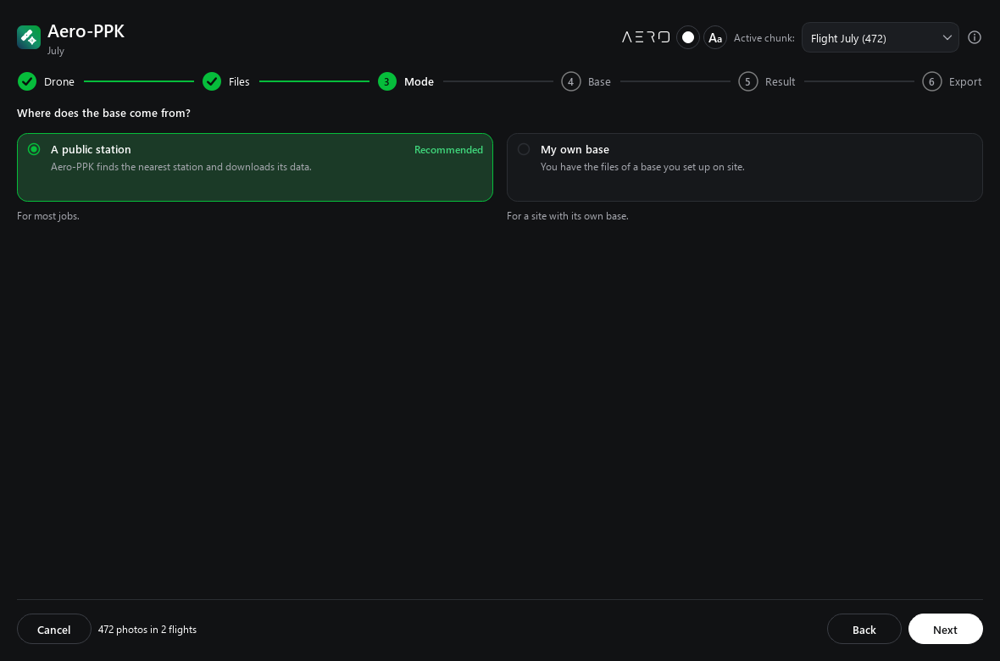
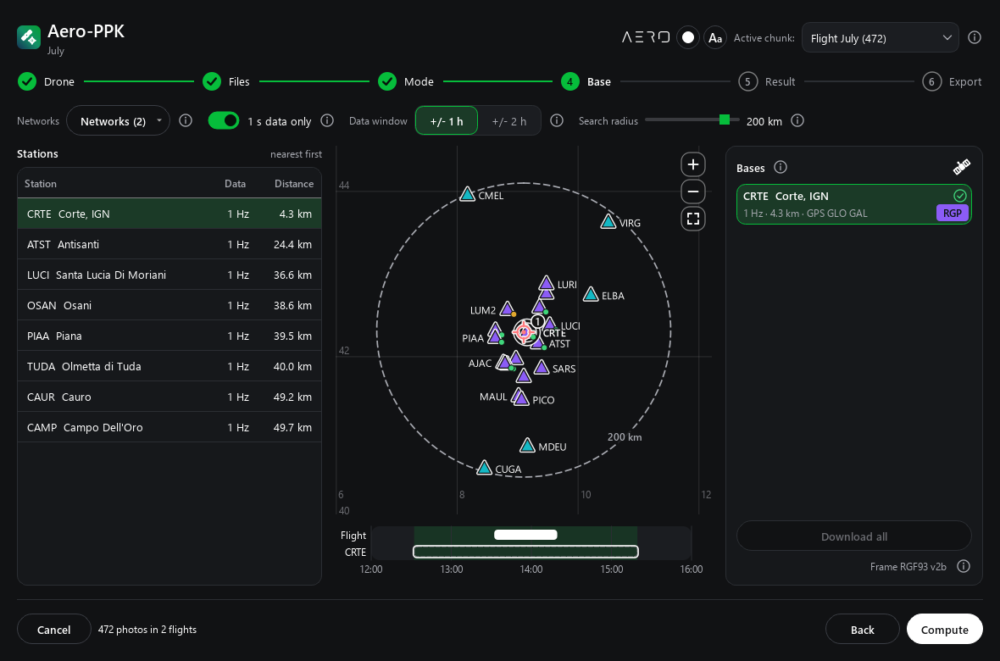
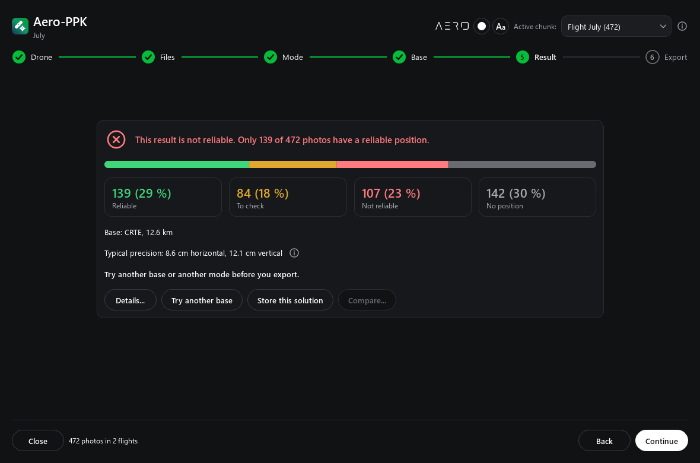
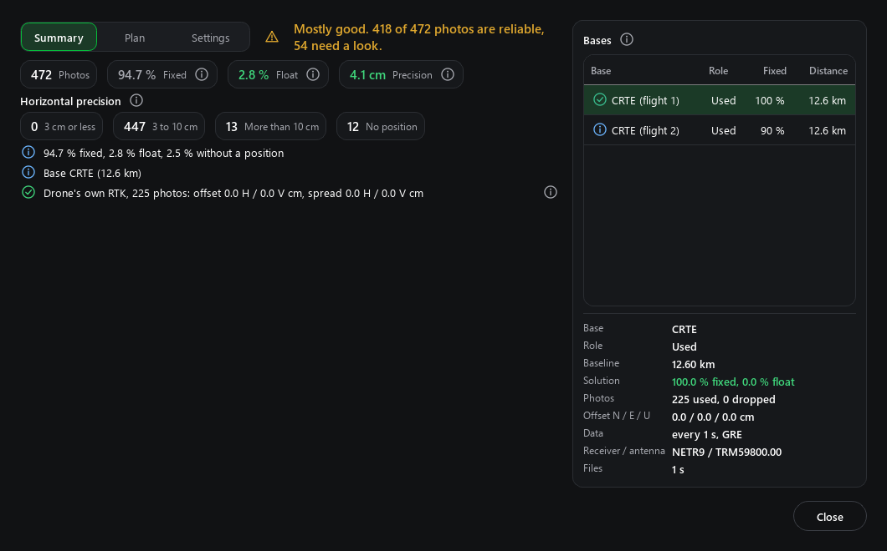
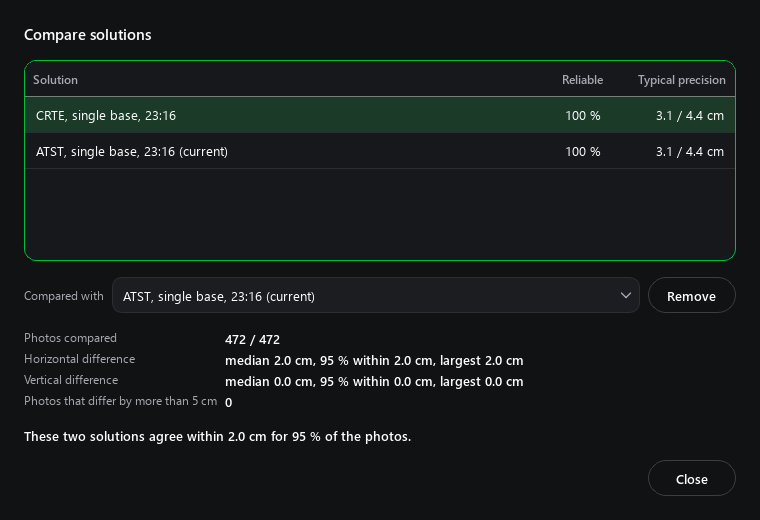
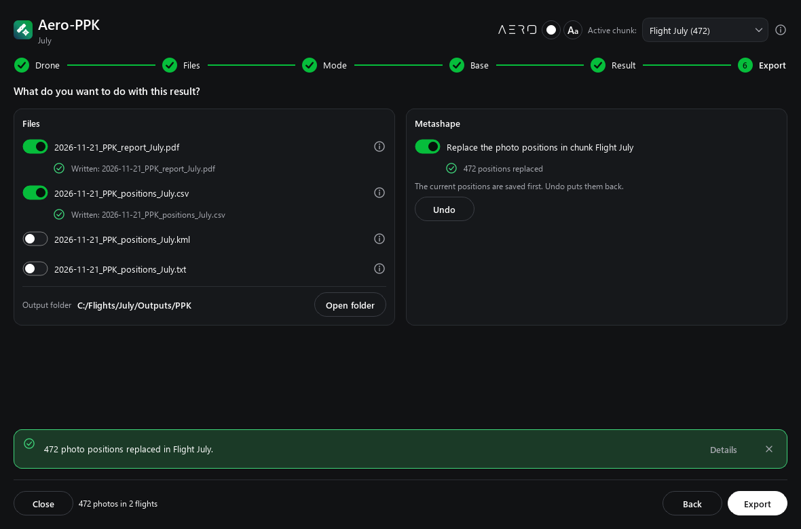

# Aero-PPK: precise positions for the photos of a drone flight

**Aero > Aero-PPK** replaces the position of every photo of a DJI Mavic 3 Enterprise flight by a post-processed (PPK) position. It
computes the positions from the satellite files the drone recorded and from the files of a base station, which is either a public
station that the tool downloads for you or a base of your own. It tells you how reliable the result is, writes the new positions into the
chunk of the open project, and can write a PDF report.

- [What you need](#what-you-need)
- [1. Drone](#1-drone)
- [2. Files](#2-files)
- [3. Mode](#3-mode)
- [4. Base](#4-base)
- [5. Result](#5-result)
- [6. Export](#6-export)
- [Coordinates](#coordinates)
- [Stations and data](#stations-and-data)
- [Limits](#limits)
- [Troubleshooting](#troubleshooting)
- [Third-party software](#third-party-software)

## What you need

- A chunk in the open Metashape project with the photos of the flight. You can also point the tool at a folder of photos.
- The files the drone wrote next to the photos: the `.MRK` file (the time of every photo), the `.obs` file (what the satellite receiver of
  the drone recorded) and the `.nav` file (the satellite orbits it received). They are in the same folder as the photos.
- An internet connection when the base is a public station. A base of your own works offline.
- NumPy, which the calculation uses. Install it from **Aero > Dependencies...** if Metashape does not have it.

Install Aero-PPK first (see the [install section of the README](../../README.md#install)). Then open **Aero > Aero-PPK**. The window
works on one chunk, the active chunk, named at the top right. The six steps are in a row under the header.

## 1. Drone

The first step asks which drone took the photos. The tool reads the photos of the active chunk and says what it found, for example
*472 photos in 2 flights, taken with DJI Mavic 3 Enterprise*. **Use chunk photos** reads the chunk again, **Folder...** reads a folder
of photos instead.

The **Device** card shows the drone that was detected, and whether its antenna is known. For the Mavic 3 Enterprise it is known and
nothing else is asked. When a device does not tell where its antenna is, an **Above camera** field appears: type the height of the
antenna above the camera, in metres.

The Mavic 3 Enterprise is the only drone tested today. A folder with the same files (`DJI_<date>_<number>_<letter>.JPG`, `_Timestamp.MRK`,
`_PPKOBS.obs`) is read the same way and is named *DJI Mavic 3 Enterprise (or same files)*. With photos that do not match, the step shows a
message and keeps the **Device** card: pick that entry and try. If it fails, **Open the user group** or **Send an email**, tell us the
model and send a sample flight (the photos and the GNSS files next to them): that is what we need to add a drone.

## 2. Files

One row per flight, with its number of photos, start time, duration and a status: *Ready*, or what is missing. Under the list, a line
says how many photos will be computed.

To leave a flight out, untick it, or right-click it and choose **Exclude flight**. It stays in the list, greyed, and is not computed,
exported or written. Its photos keep the position they have in the chunk. At least one flight must stay ticked.

Click a flight to see its three files at the bottom: the trigger file (`.MRK`), the rover observations (`.obs`) and the rover orbits
(`.nav`). If one is missing, **Browse...** lets you point to it. The **i** next to it says what the file is for. Lines in orange under
the list point out photos that are not in the chunk, photos of the chunk that no flight covers, and photos without a valid exposure time.

## 3. Mode

Where does the base come from?

- **A public station.** Aero-PPK finds the nearest station and downloads its data. This is the choice for most jobs.
- **My own base.** You have the files of a base you set up on site.

## 4. Base

With **A public station**, the step opens on a map and a list of the stations around the flight, nearest first, with the rate of their
data and their distance. Aero-PPK picks the nearest station that has data for the day of the flight and shows it in the **Bases** card
on the right. To use another one, click it on the map or in the list.

The strip above the map holds the settings:

| Setting | What it does |
|---|---|
| **Networks** | Which station networks are shown. *Automatic* shows those that have a station inside the search radius. |
| **1 s data only** | Keeps the stations that record every second, which gives better results. A station that was not looked at yet stays in the list. |
| **Data window** | Hours of base data fetched before and after the flight, 1 h or 2 h. 1 h is enough in most cases. |
| **Search radius** | Stations inside this radius are shown and listed. |

A time axis under the map shows the flight and the hours covered by the station. The line under the **Bases** card gives the reference
frame of the station. A small satellite at the top right of the card tells whether precise orbits are published for the flight day. The
calculation always uses the orbits that the drone and the station recorded.

Click **Compute**. Aero-PPK downloads what is missing from the station, then starts the calculation. The files are kept on your
computer, so a second run on the same station does not download them again.

With **My own base**, drop or browse the files of your base receiver (RINEX files, compressed or not, in any order). The tool reads them
and lists what is missing and what it may cause. Then say where the base is, in one of two ways: the position of the antenna phase
centre, or the position of the marker on the ground with the pole height and the phase centre height. Choose the reference frame of the
position you typed: it is needed to write the positions correctly. **Compute** starts the calculation.

## 5. Result

While it runs, the plan of the photos lights up as the calculation advances.

When it is done, one sentence gives the verdict and the photos are split in four counts:

| Count | Meaning |
|---|---|
| **Reliable** | The position is fixed and no check raised a flag. |
| **To check** | The position is usable, with a warning. |
| **Not reliable** | The position should not be used. |
| **No position** | Nothing could be computed for this photo. |

The verdict is *Your PPK is good* when no photo needs a look, *Mostly good* when some do, and *This result is not reliable* when more
than a quarter of the photos are not reliable. Under the counts you find the base that was used with its distance, the typical
precision, and a line of advice. The precision is a consistency figure of the calculation, not a check against ground points.

Four buttons are under the advice:

- **Details...** opens a window with the figures, the spread of the precision, the facts of the base (distance, share of fixed photos,
  receiver and antenna), a plan of the photos coloured by level, and the settings the calculation used.
- **Try another base** goes back to the Base step. This result stays until you compute again.
- **Store this solution** keeps this result in the window. Pick another base, compute again and store it too.
- **Compare...** lists the stored solutions and the current one, and says how much two of them differ over the photos they share.
  It is grey until a solution is stored. Stored solutions live in the window only and disappear when you close it.

If the result is not reliable, try another base: a station with 1 s data that is closer to the site, or your own base. When a result is
not good and you continue anyway, the tool asks once before it writes anything.

## 6. Export

Choose what to do with the result, then click **Export**.

The **Files** card lists what can be written next to the project, in the `Outputs` folder (in `PPK`), with the date and the project
name in each file name. A file that exists is never overwritten: the new one gets `_v2`.

| File | What it holds |
|---|---|
| PDF report | A report you can hand to a client: the base, the figures, a map and the table of photos. The tool asks once whether to include the table of all photos, which makes the report long when there are many photos. |
| CSV | One row per photo. |
| KML | The photo positions, for Google Earth. |
| Text file | The photo positions as a plain table. |

The **Metashape** card has **Replace the photo positions in chunk ...**. Ticked, **Export** writes the new positions into the chunk. The
tool saves the current positions first, and **Undo** puts them back. A photo with no PPK position keeps the position it has in the chunk.

## Coordinates

A position computed from a base keeps the reference frame of the base. A DJI RTK drone does the same: it writes the positions in the
frame of the network that corrected it.

- **A chunk in WGS 84** is the normal case. The positions are written as they are, in the frame of the base station. Nothing is
  converted.
- **A chunk in another coordinate system** makes the tool ask whether to **Continue in Advanced**. If you continue, the tool tells
  Metashape the frame of the base and Metashape converts the positions to the system of the chunk. Check the result in the Reference
  pane. Some height systems need a geoid grid that Metashape does not have: the tool says so and writes nothing for those photos.
- **A chunk without a coordinate system** gets no positions. Give it one first.

The frame of each station network is written next to the station, and in the report. For your own base, the frame is the one you
choose in the Base step.

## Stations and data

The public stations come from public GNSS networks that offer their files without an account: the French RGP (IGN), the European EPN,
the worldwide IGS, the American NOAA CORS and the Australian network of Geoscience Australia. Each network has its own licence, and the
PDF report names the source of the station it used. A station that two networks list is shown once.

The tool tries the best files first: 1 s data when the station has them, then coarser files. 1 s files of a recent flight may take
a few hours to appear on the servers, and daily files a day or more. Data every 30 s still work, and the report says that the data
were coarse.

## Limits

- Only the DJI Mavic 3 Enterprise is tested today. Other drones that write the same files may work; the position is only as good as the antenna offset in the `.MRK`.
- The tool needs the `.MRK`, `.obs` and `.nav` files of the drone. A flight without them cannot be computed.
- A station may have no data for the day of the flight, or files the tool cannot read. The list says so: pick another station.
- Very short flights give fewer photos to judge the result from: look at the counts and at the Details window before you trust it.
- The Australian network gives positions in the frame IGS20. The tool does not convert them to the Australian datum.
- The tool never saves your Metashape project.

## Troubleshooting

| Symptom | What to check |
|---|---|
| **Aero-PPK** is missing from the **Aero** menu | It is not installed: **Aero > Install plugins...**, then **Install** on it. |
| Aero-PPK does not open and NumPy is named as missing | Install NumPy from **Aero > Dependencies...**, then open Aero-PPK again. |
| *This drone is not supported yet* | Pick *DJI Mavic 3 Enterprise (or same files)* in the **Device** card and try. If it fails, use **Open the user group** or **Send an email** and tell us the drone. |
| A flight says *Missing* in step 2 | Point to the file with **Browse...**. The `.MRK` and `.obs` files are needed. |
| *No data from this station on the flight day* | Pick another station in the list or on the map, or widen the search radius. |
| The result says *This result is not reliable* | Click **Try another base** and pick a station that is closer and records every second, or use your own base. Look at the Details window. |
| Most photos are *To check* | The base may be far away or its data coarse. Try another base and compare the two solutions. |
| Metashape says it could not convert the positions | The chunk is not in WGS 84 and its height system needs a geoid grid that Metashape does not have. Use a chunk in WGS 84, or load the grid in Metashape. |
| You want the old positions back | **Undo** in step 6 puts back the positions saved before the last replacement in this chunk. |

## Third-party software

The positions are computed by RTKLIB (the RTKLIB-EX release), a free GNSS library that runs as a separate program next to Aero-PPK.
The licence text travels with it in `aerotools/vendor/rtklib/LICENSE.txt`, and the other third-party files of AeroTools are listed in
[THIRD_PARTY.md](../../THIRD_PARTY.md). The coordinate conversions use PROJ, which is listed there too.

A developer description of the code and of the measurements is in [AEROPPK.md](../AEROPPK.md).
