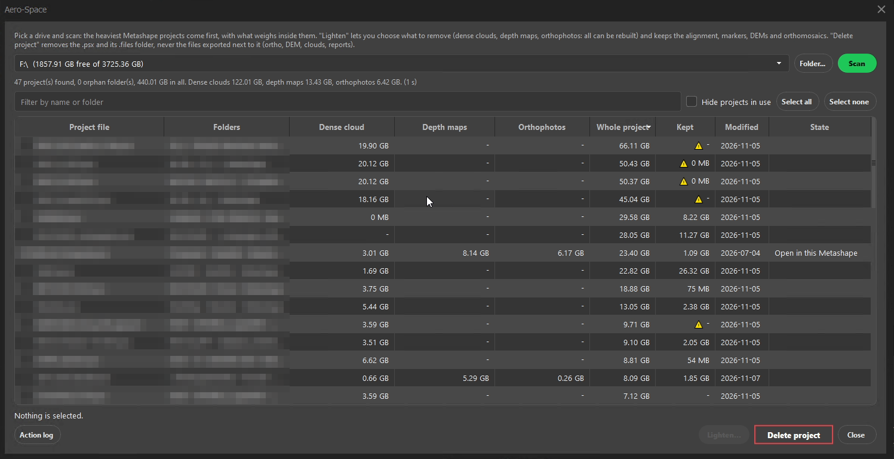
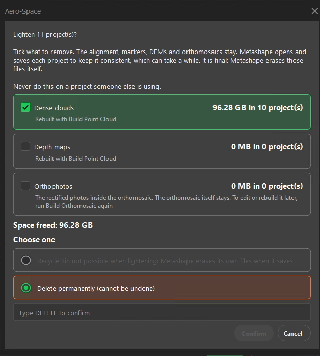
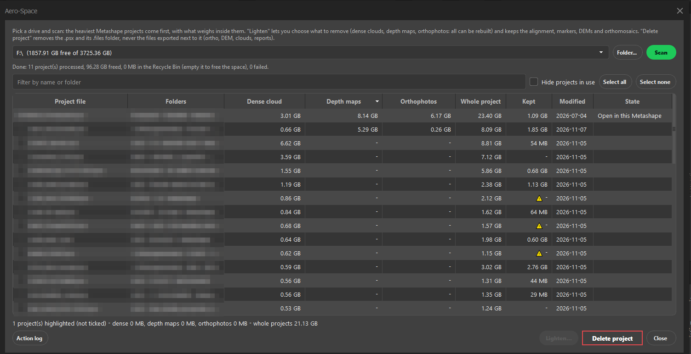

# Aero-Space: free disk space

Aero-Space finds the old Metashape projects that fill your disk, shows what weighs inside each one, and lightens or deletes them.

- [1. Scan a drive](#1-scan-a-drive)
- [2. Read the list](#2-read-the-list)
- [3. Lighten projects](#3-lighten-projects)
- [4. Delete projects](#4-delete-projects)
- [Test it on a copy first](#test-it-on-a-copy-first)

## 1. Scan a drive

Open **Aero > Aero-Space**. Pick a drive in the list (or click **Folder...** for one folder) and click **Scan**. The heaviest
projects come first. A line under the drive says how many projects were found and what the dense clouds, depth maps and
orthophotos weigh in all.

## 2. Read the list

| Column | What it shows |
|---|---|
| **Project file** and **Folders** | The `.psx` file and the three folders above it, to recognise the job. |
| **Dense cloud**, **Depth maps**, **Orthophotos** | What *Lighten* can free in this project. It can be rebuilt in Metashape, except a point cloud that was imported (LAS, LAZ...): see *Lighten projects*. |
| **Whole project** | The size of the `.psx` and its `.files` folder: what *Delete project* frees. |
| **Kept** | The files next to the project that deleting leaves alone (exported ortho, DEM, clouds, reports). Hover it for the biggest ones. |
| **Modified** | The date of the project. |
| **State** | *Open in this Metashape*, *Old lock* (left by a crash) or *Orphan* (a `.files` folder whose `.psx` is gone). |

Click a header to sort. Hover a size to see the detail (dense cloud, depth maps, tie points, DEMs, orthos). **Filter by name or
folder** narrows the list, **Hide projects in use** removes the open ones, **Select all** and **Select none** do what they say.

A warning sign in **Kept** means the project holds a DEM or an ortho built in Metashape and no exported file (tif, ecw, las,
dxf...) was found next to it. Those are inside the `.files` folder and go with the project, so export them first if you need them.

## 3. Lighten projects

Tick the projects, then click **Lighten...**. A window lists what can be removed, with the space it frees:

- **Dense clouds** and **Depth maps**: rebuilt with *Build Point Cloud*. Only clouds that Metashape built from the photos are
  removed. A cloud that was imported (LAS, LAZ...) cannot be rebuilt, so it is kept, and so is any cloud that cannot be proven
  to be a built one. The window afterwards says how many were kept.
- **Orthophotos**: the rectified photos inside the orthomosaic. The orthomosaic itself stays; to edit or rebuild it later, run
  *Build Orthomosaic* again.

The alignment, the markers, the DEMs and the orthomosaics always stay.

Lightening is final: Metashape erases those files itself when it saves the project, so there is no Recycle Bin for it. Type
`DELETE` and click **Confirm**. For each project Aero-Space then:

1. makes a **safety copy** next to the project, in a folder named `<project>_AeroSpace_backup_<date>` (the `.psx` as `.bak` and
   the small description files; a `RESTORE.txt` says how to go back). Aero-Space never deletes it: remove it yourself once the
   lightened project works;
2. opens the project in Metashape, removes what you ticked and saves it. A project with nothing to remove is not opened for
   writing, not saved and gets no safety copy. A project written by an older Metashape than the one you run is refused,
   because saving it would upgrade its file format (older versions may no longer open it): tick the box in the window to allow it;
3. opens it again to check that the alignment, the markers and the rest are unchanged.

If a step fails, the message says why and the safety copy is there. When it is over, the window says how many projects
were processed, how much was freed and how many failed.

## 4. Delete projects

Tick the projects and click **Delete project**. It removes the `.psx` and its `.files` folder, and nothing else: the files
exported next to the project are not touched. Choose where it goes:

- **Recycle Bin**: you can restore it, and the space is freed when you empty the bin. Not available on a network drive. If
  Windows asks whether to delete permanently (the project is bigger than the bin) and you accept, Aero-Space says the
  project was deleted permanently, not that it is in the bin.
- **Delete permanently**: you type `DELETE` to confirm.

## Safety rules

- A project that is open in a Metashape, even on another computer, is never touched.
- A lock left by a crash is shown as *Old lock*. Aero-Space removes it before lightening, because it would force Metashape to open the project read-only.
- Every action is written to a log: click **Action log**.

## Test it on a copy first

Copy a small project (the `.psx` and its `.files` folder) to a test folder, scan that folder, and try both modes on the copy
before using them on real work.
